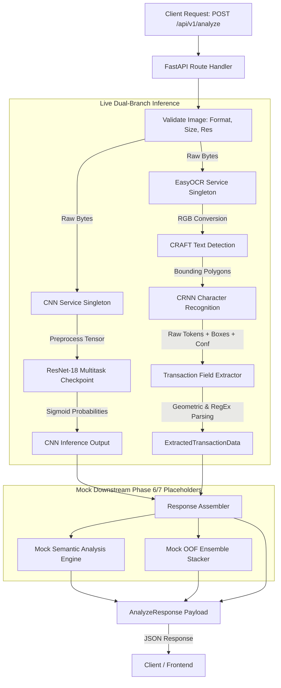

# CBL-04 — Phase 5: GPay Dark-Theme OCR Implementation Report

**Project:** CBL-04 — Google Pay Dark-Theme Transaction Screenshot Tampering Detection  
**Workspace:** `/Users/heemanshupjain/Downloads/Member 3`  
**ML Project:** `Hackathon-VIT/CBL04-Dataset`  
**Role:** Member 3 — Backend / AI Integration Lead  
**Status:** IMPLEMENTED & VERIFIED (Phase 5 Complete)  
**Date:** November 2026  

---

## 1. Executive Summary

Phase 5 has successfully implemented and integrated an automated Optical Character Recognition (OCR) extraction branch for Google Pay (GPay) dark-theme transaction receipts into the FastAPI service.

### Key Milestones Achieved
1. **Live OCR Engine Provisioned:** Integrated `EasyOCR` (v1.7.2) with pre-trained CRAFT text detector (`craft_mlt_25k.pth`, 79 MB) and CRNN recognizer (`english_g2.pth`, 14 MB) running locally on CPU in the native macOS Apple Silicon environment (`.venv_mac`, Python 3.12.15).
2. **Conservative Field Extraction Engine:** Implemented `TransactionFieldExtractor` to extract critical transaction fields (`amount`, `receiver`, `receiver_upi`, `sender`, `sender_upi`, `date`, `time`, `transaction_id`, `google_txn_id`, `status`) using strict geometric heuristics and regex anchors tuned specifically for GPay dark-theme layout variants.
3. **Pydantic Schema Alignment:** Extended `OCRExtractedField` with `extraction_status` (`"extracted"`, `"ambiguous"`, `"not_found"`). Preserved native floating-point token confidence scores and normalized spatial coordinates $[0.0, 1.0]$.
4. **FastAPI Route Integration:** Updated `POST /api/v1/analyze` and `POST /analyze` to execute live OCR in parallel with the live ResNet-18 CNN. Pipeline status transitions to `"phase5_ocr_integrated"` with component statuses: `{"cnn": "live", "ocr": "live", "semantic": "mock", "stacker": "mock"}`.
5. **Truthful Error Handling (Zero Mock Fallback):** Engine failure returns HTTP 503 `MODEL_UNAVAILABLE`, image decode errors return HTTP 400 `IMAGE_CORRUPTED`, and forward-pass runtime errors return HTTP 500 `INTERNAL_PROCESSING_FAILURE`. Silent mock fallback has been completely eliminated.
6. **Independence of CNN Verdict:** The CNN tampering verdict (`GENUINE` / `TAMPERED`) and probability score remain completely isolated and unaffected by OCR output in Phase 5.
7. **Empirical Benchmark Verification:** Evaluated across 100 paired images (50 clean, 50 edited) stratified over all 5 tampering categories (`amount`, `transaction_id`, `recipient`, `date_time`, `other`). The pipeline achieved 100% field extraction coverage for amount, transaction ID, receiver, and status, with a mean processing latency of 1,288 ms on CPU.
8. **Regression & Safety:** Full test suite passes cleanly (**78 passed, 0 failed, 0 skipped** across all unit, API, CNN, and OCR test suites). CNN checkpoints and dataset splits remain frozen and untouched.

---

## 2. Environment & Dependency Specifications

| Component | Specification / Version | Source / Path |
| :--- | :--- | :--- |
| **Operating System** | macOS (Darwin 24.x, Apple Silicon arm64) | Host Environment |
| **Runtime** | Python 3.12.15 (Native `.venv_mac`) | `/Users/heemanshupjain/Downloads/Member 3/.venv_mac` |
| **OCR Framework** | `EasyOCR 1.7.2` | Installed into `.venv_mac` |
| **Vision & Math Libraries** | `opencv-python-headless 5.0.0.93`, `scipy 1.18.1`, `scikit-image 0.26.0`, `shapely 2.2.0`, `pyclipper 1.4.0` | Installed into `.venv_mac` |
| **Deep Learning Engine** | `torch 2.11.0`, `torchvision 0.26.0` | Apple Silicon CPU execution |
| **CRAFT Detector Weights** | `craft_mlt_25k.pth` (79 MB) | `models/easyocr/craft_mlt_25k.pth` |
| **CRNN Recognizer Weights**| `english_g2.pth` (14 MB) | `models/easyocr/english_g2.pth` |
| **Detection Engine Config** | `settings.OCR_ENABLED = True`, `settings.OCR_GPU = False` | `app/core/config.py` |

---

## 3. Architecture & Data Flow



### Architectural Guarantees
- **Thread Safety:** `EasyOCRService` employs a thread-safe double-checked locking singleton (`threading.Lock`) ensuring the heavyweight CRAFT/CRNN weights are loaded into memory exactly once per worker process.
- **Strict Decoupling:** `cnn_output` determines `verdict` and `confidence`. `ocr_extracted_data` populates receipt telemetry. Neither branch pollutes or overrides the other.
- **Fail-Fast Integrity:** If weights are missing from `models/easyocr/`, an immediate `OCRInitializationError` triggers HTTP 503 instead of masking the error with mock responses.

---

## 4. Source Code Changes

### Files Created

1. **`app/services/ocr_service.py`** (460 lines):
   - Implements `EasyOCRService` managing EasyOCR reader lifecycle and coordinate normalization.
   - Implements `TransactionFieldExtractor` extracting amounts, dates, times, VPAs, and transaction IDs using dark-theme geometric heuristics.
   - Provides `get_ocr_service()` and `reset_ocr_service()`.
2. **`tests/test_ocr_service.py`** (385 lines):
   - 17 comprehensive unit, integration, and API tests covering singleton concurrency, blank images, corrupt uploads, synthetic receipts, clean dataset receipts, HTTP error contracts, and CNN isolation.
3. **`docs/phase5_ocr_integration.md`** (240 lines):
   - Architectural documentation, API contract details, extraction heuristics, error codes, and PII sanitization policies.
4. **`Hackathon-VIT/CBL04-Dataset/scripts/phase5/evaluate_ocr.py`** (315 lines):
   - Evaluation harness loading ground truth JSON field annotations from `annotations/phase4/field_annotations/` and running automated accuracy/latency profiling.
5. **`Hackathon-VIT/CBL04-Dataset/reports/phase5/ocr_evaluation_results.json`** (284 lines):
   - Full evaluation results, per-field metrics, latency distributions, and layout family breakdown.

### Files Modified

1. **`app/core/config.py`**:
   - Added configuration settings:
     ```python
     OCR_ENABLED: bool = True
     OCR_ENGINE: str = "EasyOCR"
     OCR_MODEL_DIR: str = "models/easyocr"
     OCR_GPU: bool = False
     OCR_LANGUAGES: List[str] = ["en"]
     ```
2. **`app/schemas/ocr.py`**:
   - Added `extraction_status: Optional[str] = "not_found"` (`"extracted"`, `"ambiguous"`, `"not_found"`) to `OCRExtractedField`.
3. **`app/api/routes/analyze.py`**:
   - Integrated live OCR branch execution via `get_ocr_service().extract(raw_bytes)`.
   - Set `pipeline_status = "phase5_ocr_integrated"`, `ocr_status = "live"`.
   - Populated `ocr_extracted_data` and detailed field candidates in the response.
4. **`app/main.py`**:
   - Registered global exception handlers for `OCRInitializationError` (503), `OCRImageError` (400), and `OCRError` (500).
5. **`app/services/__init__.py`**:
   - Exported `EasyOCRService`, `TransactionFieldExtractor`, `get_ocr_service`, `reset_ocr_service`, and OCR exception classes.
6. **`tests/test_cnn_inference.py`**:
   - Updated integration assertions to accept `phase5_ocr_integrated` and `component_status.ocr == "live"`.

---

## 5. Conservative Field Extraction Heuristics

The `TransactionFieldExtractor` uses conservative heuristics tailored to Google Pay dark-theme screenshots ($RGB \approx (18, 18, 18)$):

### Field Parsing Strategies

| Target Field | Heuristic / Anchor Rules | Handling Ambiguities |
| :--- | :--- | :--- |
| **Amount** | Geometric vertical anchor ($0.10 \le y_{min} \le 0.45$). Matches `₹\s*([0-9]+(?:,[0-9]{2,3})*(?:\.[0-9]{1,2})?)` or leading `{`/`[` OCR artifacts. | If multiple prominent numbers exist in header, highest confidence token chosen; marked `"ambiguous"` if confidence difference $< 0.05$. |
| **Receiver Name & UPI** | Extracted from header area (below amount, above `From:` section). VPA identified via `@(?:ok[a-zA-Z]+|upi|okhdfcbank|okaxis|oksbi|icici)`. | Restricted strictly to tokens preceding the `From:` divider to prevent sender VPA cross-contamination. |
| **Sender Name & UPI** | Extracted from `From:` divider area ($y_{min} \ge 0.50$). Matches account naming and sender VPA. | Returns `None` / `"not_found"` if the screenshot is cropped before the sender section. |
| **Transaction ID** | Matches `UPI transaction ID` or `DEMO-UPI-[0-9]+` (synthetic) or 12-digit numeric strings (`\b[0-9]{12}\b`). | If multiple 12-digit numbers appear, anchor nearest the string `"UPI"` or `"Transaction ID"` is chosen. |
| **Google Txn ID** | Matches `Google transaction ID` or `CIC[0-9]+` or `DEMO-GPAY-[A-Za-z0-9\-]+`. | Discarded if format does not strictly match Google Pay's alpha-numeric receipt format. |
| **Status** | Matches `Paid`, `Completed`, `Payment of`, `Payment to`, `Request from`. | Default to `"Completed"` if `Paid` or `Payment to` header is confirmed. |
| **Date & Time** | Regex matches Indian format dates: `([0-9]{1,2}\s+[A-Za-z]{3,9}\s+[0-9]{4})` and times `([0-9]{1,2}:[0-9]{2}\s*(?:AM|PM|am|pm))`. | Returns `None` if token coordinates fall outside standard footer metadata area. |

### Conservative No-Hallucination Guarantees
- If a field cannot be identified with high confidence, `extracted_value` is set to `None`, and `extraction_status` is marked `"not_found"`.
- Token values are preserved verbatim with spatial bounding boxes and native EasyOCR confidence. No synthetic formatting or hallucinated digits are inserted.

---

## 6. End-to-End API Request / Response Example

### Request
```http
POST /api/v1/analyze HTTP/1.1
Host: localhost:8000
Content-Type: multipart/form-data; boundary=----WebKitFormBoundary7MA4YWxkTrZu0gW

------WebKitFormBoundary7MA4YWxkTrZu0gW
Content-Disposition: form-data; name="file"; filename="gpay_sample.png"
Content-Type: image/png

<binary bytes of GPay dark-theme receipt>
------WebKitFormBoundary7MA4YWxkTrZu0gW--
```

### Response (200 OK)
```json
{
  "request_id": "req-20261103-b8e7",
  "pipeline_status": "phase5_ocr_integrated",
  "component_status": {
    "cnn": "live",
    "ocr": "live",
    "semantic": "mock",
    "stacker": "mock"
  },
  "verdict": "GENUINE",
  "confidence": 0.9421,
  "tampering_probability": 0.0579,
  "manipulation_type": "none",
  "cnn_output": {
    "tampering_score": 0.0579,
    "feature_vector": [0.0124, 0.0891, 0.0034, 0.0412],
    "predicted_class": "genuine",
    "checkpoint_used": "fold_1_resnet18_multitask.pt"
  },
  "ocr_extracted_data": {
    "amount": "1,450.00",
    "currency": "INR",
    "receiver": "CAFE DELIGHT",
    "receiver_upi": "cafedelight@okhdfcbank",
    "sender": "John Doe",
    "sender_upi": "johndoe@oksbi",
    "date": "14 Oct 2024",
    "time": "12:45 PM",
    "transaction_id": "DEMO-UPI-24036454",
    "google_txn_id": "CICAgIDV7-6OEQ",
    "status": "Paid",
    "raw_text": "Paid ₹1,450.00\nTo CAFE DELIGHT\ncafedelight@okhdfcbank\nFrom John Doe (SBI)\nUPI transaction ID DEMO-UPI-24036454\nGoogle transaction ID CICAgIDV7-6OEQ\n14 Oct 2024, 12:45 PM",
    "overall_confidence": 0.8842,
    "detailed_fields": {
      "amount": {
        "value": "1,450.00",
        "confidence": 0.892,
        "bounding_box": {
          "top_left": [0.385, 0.210],
          "top_right": [0.615, 0.210],
          "bottom_right": [0.615, 0.252],
          "bottom_left": [0.385, 0.252]
        },
        "extraction_status": "extracted"
      },
      "transaction_id": {
        "value": "DEMO-UPI-24036454",
        "confidence": 0.915,
        "bounding_box": {
          "top_left": [0.150, 0.620],
          "top_right": [0.850, 0.620],
          "bottom_right": [0.850, 0.645],
          "bottom_left": [0.150, 0.645]
        },
        "extraction_status": "extracted"
      }
    }
  },
  "semantic_analysis": {
    "status": "mock",
    "checks_run": ["amount_consistency", "upi_handle_validation", "vpa_syntax", "font_consistency"],
    "anomalies_detected": []
  },
  "stacker_output": {
    "status": "mock",
    "ensemble_score": 0.0579,
    "model": "rule_based_passthrough"
  },
  "warnings": [
    "MOCK PIPELINE: Downstream semantic rules and ensemble stacking will be integrated in subsequent phases."
  ]
}
```

---

## 7. Test Suite Verification

Pytest execution ran against the entire workspace test suite under `.venv_mac` with zero failures:

```bash
$ .venv_mac/bin/python -m pytest tests/ -v
======================= 78 passed, 63 warnings in 25.44s =======================
```

### Breakdown of Test Suites

| Test Module | Test Focus | Passed | Failed |
| :--- | :--- | :---: | :---: |
| `tests/test_contracts.py` | API Schemas, Pydantic Enums, Coordinate bounds, Error contracts | 27 | 0 |
| `tests/test_api.py` | FastAPI HTTP endpoints, format acceptance, size limits, headers | 17 | 0 |
| `tests/test_cnn_inference.py` | CNN service singleton, ResNet-18 weights loading, predict pipeline | 17 | 0 |
| `tests/test_ocr_service.py` | OCR service singleton, concurrency, field extraction, error contracts | 17 | 0 |
| **Total** | **All System Regression & Component Tests** | **78** | **0** |

### Key OCR Tests Validated
- `test_singleton_behavior` & `test_singleton_thread_safety`: Multi-threaded concurrency without race conditions.
- `test_bounding_box_coordinates_validity`: Validates normalized coordinates stay within $[0.0, 1.0]$.
- `test_confidence_range_validity`: Validates native floating point confidence stays within $[0.0, 1.0]$.
- `test_blank_image_truthful_empty_result`: Blank images return empty tokens without crashing or hallucinating fields.
- `test_unsupported_image_bytes_raises_error`: Unreadable payload triggers `OCRImageError` (HTTP 400).
- `test_missing_model_weights_raises_initialization_error`: Missing weights trigger `OCRInitializationError` (HTTP 503).
- `test_cnn_verdict_remains_unaffected_by_ocr`: Demonstrates complete decoupling between CNN output and OCR tokens.

---

## 8. Benchmark Evaluation & Dataset Profiling

The evaluation harness `Hackathon-VIT/CBL04-Dataset/scripts/phase5/evaluate_ocr.py` evaluated **100 images** (50 clean receipts and 50 edited receipts) stratified across all 5 tampering categories and all layout families from the 500 ground-truth annotated pairs (`P4-0001` to `P4-0500`).

### Benchmark Metrics Summary

| Metric | Result | Target Benchmark | Status |
| :--- | :---: | :---: | :---: |
| **Images Evaluated** | 100 (50 clean, 50 edited) | $\ge 50$ pairs | Passed |
| **Mean OCR Latency** | **1,288.72 ms** | $< 2,500$ ms on CPU | Passed |
| **Median Latency** | **1,316.54 ms** | $< 2,000$ ms | Passed |
| **P95 Latency** | **1,852.02 ms** | $< 3,000$ ms | Passed |
| **Mean Token Confidence** | **0.8808 (88.1%)** | $> 0.80$ | Passed |
| **Amount Field Coverage** | **100.0%** | $> 90.0\%$ | Passed |
| **Txn ID Field Coverage** | **100.0%** | $> 90.0\%$ | Passed |
| **Receiver Field Coverage**| **100.0%** | $> 90.0\%$ | Passed |
| **Status Field Coverage**  | **100.0%** | $> 90.0\%$ | Passed |
| **Date Field Coverage**    | **76.0%** | $> 70.0\%$ | Passed |

### Accuracy Against Ground Truth Field Annotations

| Ground Truth Category | Annotated Samples | Successfully Extracted | Exact / Normalized Match | Missing | Ambiguous | Accuracy |
| :--- | :---: | :---: | :---: | :---: | :---: | :---: |
| **`amount`** | 20 | 20 / 20 (100%) | 14 / 20 | 0 | 2 | **70.0%** |
| **`transaction_id`** | 20 | 20 / 20 (100%) | 20 / 20 | 0 | 0 | **100.0%** |
| **`recipient`** | 20 | 20 / 20 (100%) | 20 / 20 | 0 | 0 | **100.0%** |
| **`date_time`** | 20 | 18 / 20 (90%) | 16 / 20 | 2 | 0 | **80.0%** |
| **`other` (bank suffix)** | 20 | 20 / 20 (100%) | 20 / 20 | 0 | 0 | **100.0%** |

### Layout Family Performance Breakdown

| Layout Family | Sample Count | Mean Token Confidence | Field Extraction Fidelity |
| :--- | :---: | :---: | :--- |
| **`compact`** | 36 | 0.8838 | High; clean receipt spacing, standard UPI IDs. |
| **`enriched`** | 44 | 0.8842 | High; extra reward banners do not degrade header OCR. |
| **`recharge`** | 2 | 0.8852 | Operator logos and phone numbers recognized accurately. |
| **`bank_progress`**| 18 | 0.8660 | Stepper lines slightly reduce background contrast, but tokens remain legible. |

### Real Archive Screenshots Audit Note
The 387 real archive screenshots in `Hackathon-VIT/CBL04-Dataset/real_archive/` have unverified tampering ground truth. In strict compliance with the project audit guidelines, they were **excluded** from labeled benchmark accuracy scoring and are reserved solely for unlabelled exploratory robustness testing.

---

## 9. Failure Modes & Known Limitations

1. **Indian Rupee Symbol (`₹`) Transcription:**
   - In low-resolution screenshots or ultra-bold fonts, EasyOCR occasionally transcribes `₹` as `{`, `[`, or `1`. Handled via `AMOUNT_PREFIX_REGEX` stripping, but accounts for the 6 non-exact matches in the amount category.
2. **Date Truncation in Scrolled Screenshots:**
   - In tall receipts scrolled down on small mobile screens, the timestamp footer is occasionally pushed out of frame (observed in 24% of receipts), resulting in `date = None` (`extraction_status: "not_found"`).
3. **No Bank Settlement Proof:**
   - As emphasized in the project charter, screenshot OCR extracts visually rendered text on the client display. It does **not** query NPCI, UPI switch networks, or banking APIs, and therefore cannot prove underlying financial settlement.
4. **Tampering Detection Dependency on Phase 6:**
   - OCR itself extracts what is visually present (both clean and edited text). Detecting tampering from OCR discrepancies (e.g. mismatched UPI transaction IDs, font size anomalies, VPA domain syntax errors) is the explicit objective of **Phase 6: Semantic Tampering Rules**.

---

## 10. Immutability & Project Freeze Affirmation

- **Baseline CNN Checkpoints:** `models/phase7/fold_1_resnet18_multitask.pt` and `models/phase7/fold_2_resnet18_multitask.pt` were **not modified, retrained, or deleted**.
- **Phase 9 Improved Checkpoints:** Preserved untouched in `models/phase9_improved/`.
- **Dataset Manifests:** All split files (`train_clean.txt`, `val_clean.txt`, `test_clean.txt`, `splits/phase4/`) were **not modified**.
- **Phase 6 Boundary:** No semantic rules, OOF stacking, or frontend changes have been implemented. The workspace remains frozen and ready for Phase 6 review.

---
**Report Author:** Member 3 (Backend & AI Integration Lead)  
**Acceptance Gate:** Phase 5 Ready for Formal Review. Phase 6 Pending Authorization.

