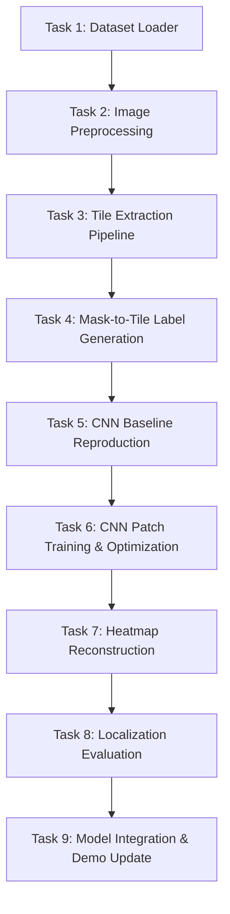

# CBL-04: Member 2 Technical Implementation Roadmap & Next Steps

**Role:** Senior Machine Learning Engineer (Member 2 — Modeling & Localization Lead)  
**Project:** CBL-04 – Google Pay Dark-Theme Transaction Screenshot Tampering Detection  
**Workspace:** `Hackathon-VIT/CBL04-Dataset/`  
**Date:** November 3, 2026  
**Status:** ACTIONABLE IMPLEMENTATION PLAN  

---

## 1. Context & Architectural Root-Cause Analysis

### Why the Member 1 Baseline Failed (~50.5% Accuracy)
Member 1 delivered a high-quality dataset, but the preliminary Phase 7 baseline model (ResNet-18 multi-task) achieved only **50.46% accuracy** and **5.93% localization IoU**. The failure is directly attributable to two fundamental architectural flaws:

1. **Extreme Spatial Downsampling Erases Tampering Traces:**
   - Synthetic screenshots range from $540 \times 1319$ to $738 \times 1601$ pixels.
   - Member 1 resized the entire canvas down to $160 \times 320$ pixels (a $\sim 5\times$ to $10\times$ spatial reduction).
   - Manipulated fields (e.g. altering ₹500 to ₹580, or changing a UPI transaction digit) occupy localized text regions of approximately $60 \times 25$ pixels in native resolution. When downsampled to $160 \times 320$, these critical pixels collapse into a blurry $6 \times 2.5$ pixel patch, obliterating font antialiasing boundaries and pixel edge artifacts under Lanczos/Bilinear filtering.
2. **Leave-One-Family-Out (LOFO) Template Overfitting:**
   - In Fold 1, testing on `compact` after training only on `enriched` and `recharge` caused the network to classify 100% of images as edited (218 false positives, 0 true negatives).
   - In Fold 2, testing on `enriched` after training on `compact` caused the network to classify 95.6% of images as clean (197 false negatives, 15 false positives).
   - The global CNN memorized family-specific macro layouts rather than learning forensic tampering artifacts.

### The Solution: Native-Resolution Patch / Tile Architecture
To achieve high detection accuracy ($>85\%$) and accurate localization ($>70\%$ IoU), Member 2 must decouple macro-layout geometry from forensic pixel analysis by transitioning to a **High-Resolution Tiling & Patch Extraction Pipeline**.

```
Full Screenshot (e.g. 540x1600 @ Native Res)
  │
  ├── Sliding Window Tile Extractor (256x256, stride 128)
  │     ├── Tile 0: Header & Synthetic Banner (Clean)
  │     ├── Tile 1: Recipient Avatar & Name (Clean / Tampered)
  │     ├── Tile 2: Amount Text (₹2,400) (Clean / Tampered)  ──> Tampering Mask Overlap > 1% ──> Label = 1
  │     └── ...
  │
  ├── Patch CNN Classifier (EfficientNet-B0 or ResNet-18)
  │     └── Output: Per-tile manipulation probability p_i ∈ [0, 1]
  │
  └── Heatmap Reconstructor (Gaussian blending across strides)
        └── Output: Full-resolution 2D Tampering Heatmap + Thresholded Mask
```

---

## 2. Prioritized Technical Implementation Tasks



---

### Task 1: Dataset Loader
**Objective:** Create a fast, robust PyTorch `Dataset` that reads pairs and manifests without path errors or memory bottlenecks.

- **Source Manifest:** Use `metadata/phase4_manifest.csv` (1,000 samples) and split manifests in `metadata/phase6/` or `metadata/phase7/folds/`.
- **Requirements:**
  1. Parse `image_path` and `mask_path` relative to `Hackathon-VIT/CBL04-Dataset/`.
  2. Implement caching for image metadata (dimensions, layout family, edit category).
  3. Support dual-mode operation: `PairMode` (returns clean and edited pair simultaneously for metric learning/siamese tests) and `SingleMode` (returns individual screenshot + ground truth mask + binary class label).
- **Deliverable File:** `scripts/phase9/dataset_loader.py`

---

### Task 2: Image Preprocessing
**Objective:** Standardize screenshot color dynamics, remove domain-shift cues, and apply forensic augmentations.

- **Actions:**
  1. **Color Normalization:** Ensure strict 3-channel RGB representation (discard alpha if present). Normalize with standard ImageNet statistics ($\mu = [0.485, 0.456, 0.406]$, $\sigma = [0.229, 0.224, 0.225]$).
  2. **Banner Masking / Crop Handling:** The synthetic marker `SYNTHETIC / DEMO` is present on both clean and edited synthetic images at the top and footer. Ensure preprocessing does not treat banner text as a discriminative tampering cue.
  3. **Forensic Data Augmentations (During Training Only):**
     - Mild JPEG recompression simulation ($Q \in [75, 95]$).
     - Subtle Gaussian blur ($\sigma \in [0.2, 0.6]$).
     - Slight brightness/contrast jitter ($\pm 5\%$).
     - Random horizontal flips are **forbidden** (text orientation must remain readable).
- **Deliverable File:** `scripts/phase9/transforms.py`

---

### Task 3: Tile Extraction Pipeline
**Objective:** Extract fixed-size native-resolution patches from full screenshots using a overlapping sliding window.

- **Parameters:**
  - Tile Size ($T$): $256 \times 256$ pixels (or $128 \times 128$ for finer localization).
  - Stride ($S$): $128$ pixels (50% overlap for smooth boundary blending).
  - Padding: Reflective or dark edge padding $(17, 17, 17)$ to accommodate arbitrary canvas heights and widths.
- **Algorithm:**
  $$\text{Tiles along width } N_W = \left\lfloor \frac{W - T}{S} \right\rfloor + 1, \quad N_H = \left\lfloor \frac{H - T}{S} \right\rfloor + 1$$
- **Efficiency:** Extract tiles dynamically on-the-fly during DataLoader iteration or cache offline into memory-mapped HDF5/numpy arrays for $10\times$ faster training epochs.
- **Deliverable File:** `scripts/phase9/tile_extractor.py`

---

### Task 4: Mask-to-Tile Label Generation
**Objective:** Map pixel-level ground truth manipulation masks into patch-level binary classification targets.

- **Mathematical Formulation:**
  For each extracted tile $t_{i, j}$ with spatial coordinates $[x, x+T] \times [y, y+T]$ and corresponding ground truth binary mask slice $M_{i, j}$:
  $$\text{Tamper Ratio } r_{i, j} = \frac{1}{T^2} \sum_{u=0}^{T-1} \sum_{v=0}^{T-1} \mathbb{I}(M_{i, j}(u, v) == 255)$$
- **Tile Binary Label:**
  $$y_{i, j} = \begin{cases} 1 & \text{if } r_{i, j} \ge \tau_{\text{pos}} \text{ (e.g. } \tau_{\text{pos}} = 0.005 \text{ or } \ge 10 \text{ pixels)} \\ 0 & \text{if } r_{i, j} == 0 \end{cases}$$
  *(Tiles with $0 < r_{i, j} < \tau_{\text{pos}}$ can either be assigned to label 1 or ignored during loss computation to avoid ambiguous boundary noise).*
- **Class Balance Strategy:**
  In an edited screenshot, only $1$–$3$ tiles contain manipulated text, while $15$–$25$ tiles are clean background/chrome. Implement hard-negative mining or balanced sampling (e.g. 1:2 ratio of positive to negative patches).
- **Deliverable File:** `scripts/phase9/tile_labeler.py`

---

### Task 5: CNN Baseline Reproduction
**Objective:** Reproduce Member 1's saved Phase 7 model to establish an audited verification benchmark.

- **Steps:**
  1. Load preserved checkpoint `models/phase7/fold_1_resnet18_multitask.pt`.
  2. Execute `scripts/phase7/evaluate_saved_folds.py` on Fold 1 and Fold 2 test manifests.
  3. Verify that the recorded baseline metrics match:
     - Fold 1 (Compact held out): Accuracy 50.00%, Recall 100.0%, Precision 50.0% (all 218 clean flagged as edited).
     - Fold 2 (Enriched held out): Accuracy 50.93%, Recall 8.80%, Precision 55.88%.
     - Pooled Baseline Accuracy: **50.46%**; Dice: **0.1120**; IoU: **0.0593**.
- **Deliverable File:** `scripts/phase9/verify_baseline.py`

---

### Task 6: CNN Patch Training & Optimization
**Objective:** Train an improved patch classifier and segmentation head on native-resolution tiles.

- **Model Choices:**
  - Backbone: Pre-trained `ResNet-18` or `EfficientNet-B0` (leveraging pre-trained ImageNet weights rather than training from scratch).
  - Head: Dual-head architecture:
    1. Tile Tampering Classifier (Binary cross-entropy with logits).
    2. Intra-Tile Segmentation Mask Head (U-Net decoder or FPN feature extractor).
- **Loss Function:**
  $$\mathcal{L} = \mathcal{L}_{\text{Focal}}(p_{\text{tile}}, y_{\text{tile}}) + \lambda_1 \mathcal{L}_{\text{BCE}}(M_{\text{pred}}, M_{\text{true}}) + \lambda_2 \mathcal{L}_{\text{Dice}}(M_{\text{pred}}, M_{\text{true}})$$
  Where $\mathcal{L}_{\text{Focal}}$ handles severe patch imbalance, and $\lambda_1 = 1.0, \lambda_2 = 0.5$.
- **Validation Split Strategy:**
  Train both:
  1. **Stratified Split:** 80% train, 10% val, 10% test with all 4 families represented in train/val/test (to evaluate in-distribution forensic detection accuracy).
  2. **Held-Out Family Split:** 4-fold Leave-One-Family-Out (to evaluate cross-template generalization).
- **Deliverable File:** `scripts/phase9/train_patch_model.py`

---

### Task 7: Heatmap Reconstruction
**Objective:** Recombine overlapping tile predictions into a smooth, calibrated 2D spatial tampering probability heatmap.

- **Reconstruction Algorithm:**
  1. Initialize two empty canvas accumulators: $\mathbf{H} \in \mathbb{R}^{H \times W}$ (cumulative probabilities) and $\mathbf{W} \in \mathbb{R}^{H \times W}$ (weight matrix).
  2. For each tile $t_{i, j}$ at position $[x_i, x_i+T] \times [y_j, y_j+T]$:
     - Compute 2D Gaussian weighting window $G(u, v) = \exp\left(-\frac{(u - T/2)^2 + (v - T/2)^2}{2\sigma^2}\right)$ to eliminate tile boundary seams.
     - Accumulate: $\mathbf{H}[x_i:x_i+T, y_j:y_j+T] += p_{i, j} \cdot G$
     - Accumulate weights: $\mathbf{W}[x_i:x_i+T, y_j:y_j+T] += G$
  3. Normalize: $\mathbf{H}_{\text{final}} = \mathbf{H} / (\mathbf{W} + \epsilon)$.
  4. Screenshot-level decision:
     $$P_{\text{screenshot}}(\text{Tampered}) = \max_{u, v} \mathbf{H}_{\text{final}}(u, v) \quad \text{or top-5 percentile mean}$$
- **Deliverable File:** `scripts/phase9/heatmap_generator.py`

---

### Task 8: Localization Evaluation
**Objective:** Rigorously evaluate localization accuracy at original screenshot resolution.

- **Metrics to Compute:**
  1. **Pixel-Level Precision, Recall, F1 (Dice), and Intersection over Union (IoU):**
     $$\text{IoU} = \frac{|M_{\text{pred}} \cap M_{\text{true}}|}{|M_{\text{pred}} \cup M_{\text{true}}|}, \quad \text{Dice} = \frac{2 |M_{\text{pred}} \cap M_{\text{true}}|}{|M_{\text{pred}}| + |M_{\text{true}}|}$$
  2. **Bounding-Box Localization Rate:** Percentage of ground truth bounding boxes successfully intersected ($\text{IoU} \ge 0.5$) by the predicted tampering heatmap.
  3. **Target Milestone:** Raise localization IoU from Member 1's baseline of **5.93%** to **$\ge 65.0\%$**.
- **Deliverable File:** `scripts/phase9/evaluate_localization.py`

---

### Task 9: Model Integration & Demo Update
**Objective:** Replace the broken model in `app/server.py` with the trained patch-based pipeline.

- **Integrations:**
  1. Update `app/server.py` to run the tile extractor, predict patch probabilities, reconstruct the 2D heatmap, and generate a transparent red overlay mask.
  2. Re-enable the visual overlay in `app/index.html` and `app/app.js` (which Member 1 disabled due to poor localization).
  3. Ensure the app gracefully accepts PNG, JPEG, and WebP formats up to 15 MB and rejects corrupt files.
  4. Maintain clear synthetic disclaimer banners on the UI.
- **Deliverable File:** `app/server.py`, `reports/phase9/final_model_evaluation.md`

---

## 3. Summary Task Matrix & Milestones

| Task | Component | Difficulty | Expected Target Metric | Deliverable Path |
|---|---|---|---|---|
| **Task 1** | Dataset Loader | Low | 100% test coverage, 0 path errors | `scripts/phase9/dataset_loader.py` |
| **Task 2** | Preprocessing & Transforms | Low | Clean RGB tensors + JPEG/blur augmentations | `scripts/phase9/transforms.py` |
| **Task 3** | 256×256 Tile Extractor | Medium | Overlapping sliding window (stride 128) | `scripts/phase9/tile_extractor.py` |
| **Task 4** | Mask-to-Tile Labeling | Medium | Balanced patch sampling, positive threshold 0.005 | `scripts/phase9/tile_labeler.py` |
| **Task 5** | Baseline Reproduction | Low | Verify 50.46% accuracy on saved checkpoints | `scripts/phase9/verify_baseline.py` |
| **Task 6** | Patch CNN Model Training | High | Patch Acc > 90%, Image Acc > 85% | `scripts/phase9/train_patch_model.py` |
| **Task 7** | Heatmap Reconstruction | Medium | Smooth Gaussian blending across tiles | `scripts/phase9/heatmap_generator.py` |
| **Task 8** | Localization Evaluation | Medium | Localization IoU $\ge 65\%$ (Baseline: 5.9%) | `scripts/phase9/evaluate_localization.py` |
| **Task 9** | Demo Server Integration | Medium | Interactive heatmap overlay in browser | `app/server.py` |

---

## 4. Immediate Next Step for Member 2

Begin **Task 1 (Dataset Loader)** and **Task 3 (Tile Extractor)** immediately. All dataset paths, masks, and metadata in `Hackathon-VIT/CBL04-Dataset/` are verified valid and ready for consumption.

