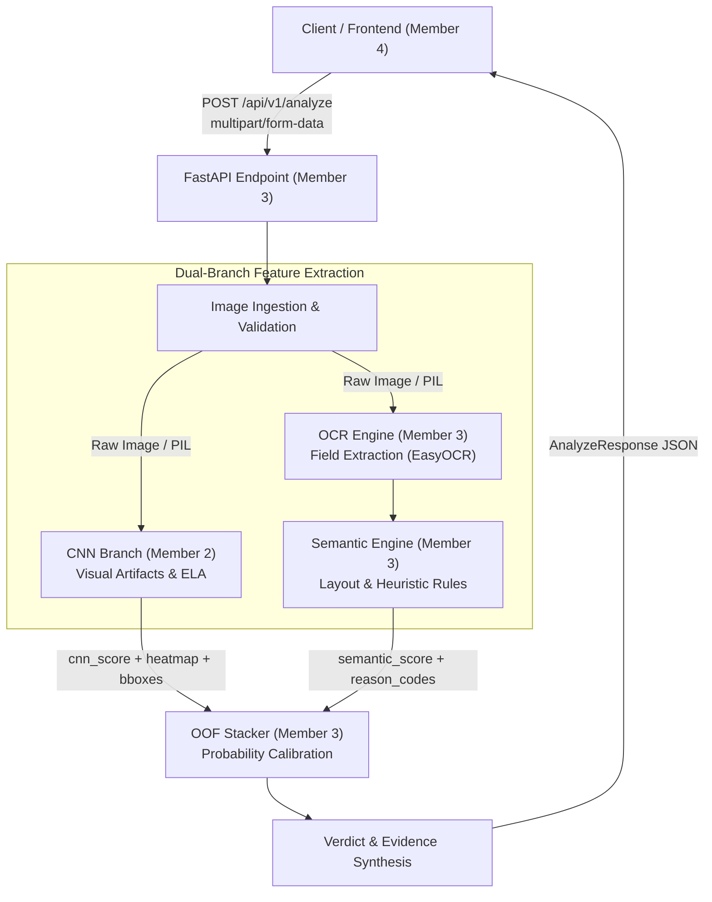

# CBL-04: Google Pay Screenshot Manipulation Detection
## Phase 1 API and Model Contracts Specification

**Author:** Member 3 (OCR Extraction, Semantic Analysis, OOF Stacker, Backend API)  
**Collaborators:** Member 2 (CNN Image Manipulation Model), Member 4 (Frontend Development & Integration)  
**Status:** ✅ Phase 1 Complete (Contracts Finalized & Tested)  
**Target Backend Framework:** FastAPI (Python 3.10+)  
**Specification Version:** `v1.0.0`  
**Date:** 2026-11-03  

---

## 1. API Contract Overview

The CBL-04 detection system is designed to verify Google Pay (GPay) transaction screenshots and detect digital manipulation, font splicing, layout tampering, and synthetic generation. The architecture comprises two specialized feature extraction branches and a meta-ensemble:

1. **CNN Visual Branch (Member 2):** Deep neural network (e.g. EfficientNet + Error Level Analysis) detecting localized pixel-level manipulation, unnatural noise gradients, and resampling artifacts, generating a Grad-CAM heatmap and suspicious bounding regions.
2. **OCR & Semantic Branch (Member 3):** Optical Character Recognition (EasyOCR) extracting key transaction fields (Amount, UPI Ref ID, Date, Sender, Receiver, Status), evaluating layout geometries, font proportions, and banking regex rules, producing structured reason codes and field-level anomaly flags.
3. **Out-of-Fold (OOF) Stacker (Member 3):** Calibrated meta-classifier (e.g., LightGBM / Logistic Regression) fusing CNN probabilities and semantic feature signals into an overarching authenticity verdict (`GENUINE`, `SUSPICIOUS`, `EDITED`, `INCONCLUSIVE`).



---

## 2. API Request Contract

### Endpoint Specification
- **Path:** `/api/v1/analyze` (Alias: `/analyze`)
- **HTTP Method:** `POST`
- **Content-Type:** `multipart/form-data`

### Image Transfer Protocol
Binary file transmission via standard `multipart/form-data` multipart boundary streams. This approach prevents client-side base64 encoding memory expansion (~33% overhead) and enables streaming directly to disk or in-memory OpenCV/Pillow buffers.

### Parameters
| Field Name | Transfer Mechanism | Type | Required | Description |
|---|---|---|---|---|
| `image` | Multipart File | Binary Stream | **Yes** | The receipt screenshot to analyze (`.jpg`, `.jpeg`, `.png`, `.webp`). |
| `request_id` | Form Field | String | No | Client correlation trace ID (e.g., UUIDv4). If omitted, backend generates one. |
| `return_heatmap`| Form Field | Boolean | No | Whether to compute and return Grad-CAM spatial heatmap. Default: `true`. |
| `metadata` | Form Field | JSON String | No | Optional client metadata (device model, platform, client version). |

### Upload Constraints & Validation Rules
- **Supported MIME Types:** `image/jpeg`, `image/png`, `image/webp`.
- **Supported File Extensions:** `.jpg`, `.jpeg`, `.png`, `.webp` (case-insensitive).
- **Minimum File Size:** `1 byte` (0-byte empty files rejected immediately with `400 Bad Request`).
- **Maximum File Size:** Configurable via `ImageUploadConfig.max_file_size_bytes` (Default: `10 MB` = `10,485,760 bytes`; requests exceeding limit rejected with `413 Payload Too Large`).
- **Allowed Dimensions:** Min `100 × 100 px`, Max `4096 × 4096 px`.
- **Integrity Rule:** Screenshots are **never** assumed authentic simply because they visually resemble Google Pay. Every screenshot undergoes full pipeline inference.

---

## 3. Coordinate Conventions & Bounding Boxes

To ensure compatibility across client-side Canvas overlays and machine learning pipelines, two coordinate representations are formally specified:

### A. Normalized Coordinates (`NormalizedBoundingBox`) — *Canonical ML Convention*
- **Origin `(0.0, 0.0)`:** Top-Left corner of original natural image.
- **Corner `(1.0, 1.0)`:** Bottom-Right corner of original natural image.
- **Fields:**
  - `xmin`: Left edge float $[0.0, 1.0]$
  - `ymin`: Top edge float $[0.0, 1.0]$
  - `xmax`: Right edge float $[0.0, 1.0]$
  - `ymax`: Bottom edge float $[0.0, 1.0]$
- **Invariant:** $0.0 \le x_{min} \le x_{max} \le 1.0$ and $0.0 \le y_{min} \le y_{max} \le 1.0$.
- **Advantage:** Resolution-independent; persists across image downsampling, responsive mobile views, and model input resizing.

### B. Pixel Coordinates (`PixelBoundingBox`) — *Frontend Rendering Convention*
- **Origin `(0, 0)`:** Top-Left corner in absolute integer/float pixels.
- **Fields:**
  - `x`: Top-left horizontal pixel offset
  - `y`: Top-left vertical pixel offset
  - `width`: Bounding box width in pixels
  - `height`: Bounding box height in pixels
- **Conversion Formulations:**
  $$\text{pixel.x} = \text{xmin} \times \text{image\_width}$$
  $$\text{pixel.y} = \text{ymin} \times \text{image\_height}$$
  $$\text{pixel.width} = (\text{xmax} - \text{xmin}) \times \text{image\_width}$$
  $$\text{pixel.height} = (\text{ymax} - \text{ymin}) \times \text{image\_height}$$

---

## 4. OCR Output Contract (`app/schemas/ocr.py`)

The OCR extraction branch isolates key transaction fields. OCR fields may be missing or occluded; the contract guarantees that missing fields return `null` without throwing runtime exceptions.

### Individual Extracted Field (`OCRExtractedField`)
```python
class OCRExtractedField(BaseSchema):
    field_name: str                         # e.g. "amount", "transaction_id"
    raw_text: Optional[str]                 # Exact OCR detected text
    confidence: Optional[float]             # Token recognition confidence [0.0 - 1.0]
    bounding_box: Optional[NormalizedBoundingBox] # [0.0 - 1.0]
    pixel_box: Optional[PixelBoundingBox]   # Absolute pixels
    normalized_value: Optional[Any]         # e.g., float(1500.0) or ISO string
    is_detected: bool                       # True if localized and parsed
```

### Aggregated Transaction Metadata (`ExtractedTransactionData`)
Directly maps to the frontend `ocr_data` contract card:
- `transaction_id`: Optional 12-digit UPI RRN (e.g. `"430829103842"`) or Google Transaction ID.
- `amount`: Formatted amount with currency symbol (e.g. `"₹1,500.00"`).
- `amount_numeric`: Normalized numeric float (e.g. `1500.00`).
- `currency`: Currency code (Default: `"INR"`).
- `date`: Extracted transaction date (e.g. `"2026-11-03"`).
- `time`: Extracted transaction time (e.g. `"14:30:00"`).
- `sender`: Sender display name (e.g. `"Rahul Sharma"`).
- `sender_upi`: Sender VPA handle (e.g. `"rahul@okaxis"`).
- `receiver`: Payee or merchant name (e.g. `"Cafe Delight"`).
- `receiver_upi`: Payee VPA handle (e.g. `"cafedelight@okhdfcbank"`).
- `status`: Payment status string (e.g. `"Completed"`, `"Paid"`, `"Payment to"`).
- `google_txn_id`: Google internal alphanumeric ID if present.

---

## 5. CNN Interface Contract (`app/schemas/cnn.py`)

**Designed for Member 2 integration.** Member 2 can plug in their CNN model without requiring modifications to the API contract.

### Abstract Interface Protocol
```python
class CNNInferenceInterface(ABC):
    @abstractmethod
    def predict(self, input_data: CNNModelInput) -> CNNModelOutput:
        """Executes forward inference and spatial localization."""
        pass

    @abstractmethod
    def get_model_info(self) -> ModelVersionInfo:
        """Returns architecture name, weights hash, and semantic version."""
        pass
```

### Input Specification (`CNNModelInput`)
- `image_bytes`: Binary bytes of the screenshot.
- `image_path`: Filesystem path to cached image on disk (if disk caching enabled).
- `image_dimensions`: Tuple `(width, height)` of original image.
- `generate_heatmap`: Boolean request flag (Default: `True`).
- `device`: Compute device (`"cpu"`, `"cuda"`, `"mps"`).

### Output Specification (`CNNModelOutput`)
- `manipulation_probability`: Float $[0.0, 1.0]$ representing probability of visual manipulation ($0.0 = \text{Clean}, 1.0 = \text{Manipulated}$).
- `raw_logits`: Optional unnormalized logits list $[z_0, z_1]$.
- `heatmap_data_uri`: Optional Base64 data URI string (`"data:image/png;base64,..."`).
- `heatmap_relative_path`: Optional relative static file URL (`"static/heatmaps/<id>.png"`).
- `suspicious_regions`: List of `CNNSuspiciousRegion` entries:
  - `label`: String identifier (e.g., `"Amount field splicing"`, `"Font artifact cluster"`).
  - `score`: Localized probability $[0.0, 1.0]$.
  - `bbox_normalized`: `NormalizedBoundingBox` ($[0.0, 1.0]$).
  - `bbox_pixel`: Optional `PixelBoundingBox`.
  - `anomaly_type`: Artifact label (`"splicing"`, `"resampling"`, `"noise_inconsistency"`).
- `model_info`: `ModelVersionInfo` (model name, version, architecture).
- `inference_time_ms`: Execution latency in milliseconds.

---

## 6. Semantic Analysis Contract (`app/schemas/semantic.py`)

The OCR and Semantic branch extracts structured geometric and banking heuristic features, outputting an explainable feature vector, field anomaly flags, and machine-readable reason codes.

### Reason Codes (`ReasonCodeEnum`)
All reason codes represent objective, verifiable visual or syntactic anomalies. **They never declare legal fraud or imply bad faith.**

| Reason Code | Category | Explanation |
|---|---|---|
| `AMOUNT_FORMAT_ANOMALY` | Financial Format | Amount digits, comma grouping, or formatting deviates from standard GPay. |
| `AMOUNT_CURRENCY_SYMBOL_MISMATCH` | Typography | Rupee symbol (₹) font glyph or alignment does not match official typography. |
| `AMOUNT_DECIMAL_ANOMALY` | Financial Format | Inconsistent or missing decimal formatting. |
| `TEXT_LAYOUT_INCONSISTENCY` | Geometry | Text baseline shifts or horizontal/vertical bounding box misalignment. |
| `FONT_PROPORTION_ANOMALY` | Typography | Stroke width or glyph aspect ratio deviates from Google Sans / Roboto. |
| `STATUS_TEXT_ANOMALY` | Interface Pattern | Unexpected casing or unauthorized wording in status label (e.g. 'Paid Success'). |
| `REF_ID_FORMAT_ANOMALY` | Banking Standards | UPI Reference Number (RRN) is not exactly 12 numeric digits. |
| `UPI_ID_SYNTAX_INVALID` | Banking Standards | Payee/Payer VPA does not match standard `handle@bank` syntax. |
| `TRANSACTION_FIELD_INCONSISTENCY`| Cross-field Logic | Conflicting metadata between complementary receipt fields. |
| `TIMESTAMP_CHRONOLOGY_ANOMALY`| Temporal Logic | Date represents a future timestamp or invalid calendar date. |
| `SENDER_RECEIVER_IDENTICAL` | Transaction Logic| Payer and payee display names or UPI IDs are identical. |
| `MISSING_CRITICAL_PAYMENT_FIELD`| Completeness | Core payment elements (amount, status, or date) were unreadable. |
| `COMPRESSION_MISMATCH_DETECTED` | Digital Signal | Spatial divergence in localized JPEG compression or ELA signature. |
| `OCR_CONFIDENCE_LOW` | Image Quality | Mean OCR token recognition confidence fell below tolerance threshold. |
| `INTEGRITY_VERIFIED_CLEAN` | Baseline Integrity | Layout, fonts, and banking syntax match genuine GPay specifications. |

### Semantic Branch Output (`SemanticBranchOutput`)
- `semantic_manipulation_score`: Float $[0.0, 1.0]$ from rule engine and tabular heuristics.
- `feature_vector`: `SemanticFeatureVector` (15+ structured boolean/continuous features).
- `reason_codes`: List of `ReasonCodeEnum`.
- `field_anomalies`: `FieldAnomalyIndicators` (`amount_anomaly`, `recipient_anomaly`, `status_anomaly`, `date_anomaly`, `ref_id_anomaly`, `layout_anomaly`).
- `ocr_confidence_info`: `OCRConfidenceInfo` (`average_confidence`, `min_field_confidence`, `critical_fields_confidence`).
- `model_info`: `ModelVersionInfo`.
- `processing_time_ms`: Wall-clock latency.

---

## 7. OOF Stacker Interface Contract (`app/schemas/stacker.py`)

The Out-Of-Fold (OOF) stacker fuses first-stage outputs from Member 2's CNN branch and Member 3's Semantic branch into a single calibrated probability.

### Stacker Input (`StackerInput`)
```python
class StackerInput(BaseSchema):
    cnn_score: float                        # Visual artifact score [0.0 - 1.0]
    semantic_score: float                   # Layout & semantic score [0.0 - 1.0]
    additional_branch_scores: Optional[Dict[str, float]] # e.g. {'ela_score': 0.72}
    feature_vector: Optional[List[float]]   # Flattened semantic features
    cnn_model_version: str                  # CNN provenance
    semantic_model_version: str             # Semantic provenance
```

### Stacker Output (`StackerOutput`)
```python
class StackerOutput(BaseSchema):
    final_manipulation_probability: float   # Ensembled probability [0.0 - 1.0]
    calibrated_confidence: float            # Calibrated certainty [0.0 - 1.0]
    stacker_model_version: str              # e.g. 'oof_stacker_lgbm_v1.0'
    decision_metadata: Optional[CalibrationMetadata] # Calibration parameters
    inference_time_ms: float
```

> **Important Note:** Decision thresholds must **not** be hardcoded arbitrarily. In Phase 6, thresholds will be systematically tuned and calibrated using held-out cross-validation curves.

---

## 8. Final API Response Contract (`app/schemas/response.py`)

Standardized response returned by `/api/v1/analyze`. Completely backwards-compatible with Member 4's frontend while delivering full multi-model transparency.

### Field Definitions
- `request_id`: Request correlation ID.
- `verdict`: Canonical enum (`GENUINE`, `SUSPICIOUS`, `EDITED`, `INCONCLUSIVE`). Backwards-compatible aliases (`REAL` maps to `GENUINE`, `FAKE` maps to `EDITED`).
- `confidence`: Calibrated certainty $[0.0, 1.0]$ in the assigned verdict.
- `manipulation_probability`: Probability $[0.0, 1.0]$ that screenshot is edited/fabricated.
- `message`: Human-readable summary for end-user display.
- `ocr_data`: Formatted metadata object for `OCRDataCard.jsx`.
- `manipulation_analysis`: Visual evidence container for `ResultsDashboard.jsx` and `HeatmapView.jsx`:
  - `detected`: Boolean flag indicating if manipulation was localized.
  - `suspicious_regions`: List of localized boxes with pixel $(x, y, w, h)$ coordinates and normalized bounds.
  - `heatmap_url`: URL or data URI to Grad-CAM heatmap.
- `branch_scores`: Granular breakdown (`cnn_score`, `semantic_score`, `stacker_score`).
- `reason_codes`: Array of machine-readable anomaly identifiers.
- `model_versions`: Complete audit trail of pipeline components.
- `processing_time_ms`: End-to-end execution duration in milliseconds.
- `warnings`: Non-fatal processing warnings (e.g., low image resolution, heavy blur).
- `disclaimer`: Mandatory legal notice:
  > *"Notice: Screenshot analysis performs digital artifact and layout integrity checks only. It does not verify bank-side settlement, banking ledger entries, or prove that a financial payment occurred."*

---

## 9. Error Contract (`app/schemas/errors.py`)

All 4xx and 5xx responses strictly adhere to `APIErrorResponse`. Internal filesystem paths, server stack traces, and database credentials are automatically redacted before transmission.

### Schema
```json
{
  "error_code": "FILE_TOO_LARGE",
  "message": "Image file size (15728640 bytes) exceeds the maximum allowed limit of 10.0 MB.",
  "detail": null,
  "request_id": "req-trace-456",
  "status_code": 413,
  "timestamp": "2026-11-03T15:30:00.000000+00:00"
}
```

### Standard HTTP Status & Error Code Map
| HTTP Status | Error Code | Trigger Condition |
|---|---|---|
| `400 Bad Request` | `CORRUPT_IMAGE` | Zero-byte upload or image unreadable by decoders. |
| `400 Bad Request` | `MISSING_REQUIRED_INPUT` | Missing `image` multipart parameter. |
| `413 Payload Too Large`| `FILE_TOO_LARGE` | Upload exceeds 10 MB limit. |
| `415 Unsupported Media`| `INVALID_IMAGE_FORMAT` | File format is not JPEG, PNG, or WebP. |
| `422 Unprocessable` | `VALIDATION_ERROR` | Dimensions below $100 \times 100\text{px}$ or malformed form field. |
| `500 Internal Error` | `INTERNAL_PROCESSING_FAILURE`| Unhandled pipeline exception (sanitized message returned). |
| `503 Unavailable` | `MODEL_UNAVAILABLE` | CNN or OCR model checkpoint failed to load or compute. |
| `504 Gateway Timeout`| `INFERENCE_TIMEOUT` | Inference exceeded 45-second pipeline grace threshold. |

---

## 10. Example Payloads

### A. Example 1: Detected Tampered / Edited Receipt (`EDITED`)
```json
{
  "request_id": "trace-fake-001",
  "verdict": "EDITED",
  "confidence": 0.95,
  "manipulation_probability": 0.94,
  "message": "Analysis completed. Image exhibits localized tampering around amount and font inconsistencies.",
  "ocr_data": {
    "transaction_id": "UPI/234809283402",
    "amount": "₹5,000",
    "amount_numeric": 5000.0,
    "currency": "INR",
    "date": "2026-11-03",
    "time": "14:30:00",
    "sender": "Rahul Sharma",
    "sender_upi": "rahul@okaxis",
    "receiver": "Merchant Store",
    "receiver_upi": "store@okhdfcbank",
    "status": "Paid",
    "google_txn_id": null
  },
  "manipulation_analysis": {
    "detected": true,
    "suspicious_regions": [
      {
        "label": "Amount field",
        "score": 0.94,
        "x": 100.0,
        "y": 200.0,
        "width": 140.0,
        "height": 48.0,
        "box_normalized": {
          "xmin": 0.0926,
          "ymin": 0.0833,
          "xmax": 0.2222,
          "ymax": 0.1033
        }
      },
      {
        "label": "Transaction ID alignment",
        "score": 0.88,
        "x": 80.0,
        "y": 350.0,
        "width": 260.0,
        "height": 32.0,
        "box_normalized": {
          "xmin": 0.0741,
          "ymin": 0.1458,
          "xmax": 0.3148,
          "ymax": 0.1592
        }
      }
    ],
    "heatmap_url": "http://localhost:8000/static/heatmaps/trace-fake-001.png"
  },
  "branch_scores": {
    "cnn_score": 0.95,
    "semantic_score": 0.92,
    "stacker_score": 0.94,
    "additional_scores": {
      "ela_compression_score": 0.89
    }
  },
  "cnn_score": 0.95,
  "semantic_score": 0.92,
  "stacker_score": 0.94,
  "reason_codes": [
    "AMOUNT_FORMAT_ANOMALY",
    "TEXT_LAYOUT_INCONSISTENCY",
    "COMPRESSION_MISMATCH_DETECTED"
  ],
  "model_versions": {
    "pipeline_version": "v1.0.0",
    "cnn_model_version": "EfficientNet-B4_v1.0.0",
    "ocr_engine_version": "EasyOCR_v1.7.2",
    "semantic_engine_version": "GPay_Semantic_v1.0.0",
    "stacker_model_version": "OOF_Stacker_LGBM_v1.0.0"
  },
  "processing_time_ms": 1845.2,
  "warnings": [],
  "disclaimer": "Notice: Screenshot analysis performs digital artifact and layout integrity checks only. It does not verify bank-side settlement, banking ledger entries, or prove that a financial payment occurred."
}
```

### B. Example 2: Verified Authentic Receipt (`GENUINE`)
```json
{
  "request_id": "trace-real-002",
  "verdict": "GENUINE",
  "confidence": 0.98,
  "manipulation_probability": 0.02,
  "message": "Analysis completed. Receipt integrity verified; no manipulation detected.",
  "ocr_data": {
    "transaction_id": "CIC492049203",
    "amount": "₹350",
    "amount_numeric": 350.0,
    "currency": "INR",
    "date": "2026-11-03",
    "time": "11:15:22",
    "sender": "Priya Patel",
    "sender_upi": "priya@oksbi",
    "receiver": "Cafe Delight",
    "receiver_upi": "cafedelight@okhdfcbank",
    "status": "Completed",
    "google_txn_id": "CIC492049203"
  },
  "manipulation_analysis": {
    "detected": false,
    "suspicious_regions": [],
    "heatmap_url": null
  },
  "branch_scores": {
    "cnn_score": 0.03,
    "semantic_score": 0.01,
    "stacker_score": 0.02,
    "additional_scores": null
  },
  "cnn_score": 0.03,
  "semantic_score": 0.01,
  "stacker_score": 0.02,
  "reason_codes": [
    "INTEGRITY_VERIFIED_CLEAN"
  ],
  "model_versions": {
    "pipeline_version": "v1.0.0",
    "cnn_model_version": "EfficientNet-B4_v1.0.0",
    "ocr_engine_version": "EasyOCR_v1.7.2",
    "semantic_engine_version": "GPay_Semantic_v1.0.0",
    "stacker_model_version": "OOF_Stacker_LGBM_v1.0.0"
  },
  "processing_time_ms": 1420.8,
  "warnings": [],
  "disclaimer": "Notice: Screenshot analysis performs digital artifact and layout integrity checks only. It does not verify bank-side settlement, banking ledger entries, or prove that a financial payment occurred."
}
```

---

## 11. Integration Notes for Team Members

### For Member 2 (CNN Image Manipulation Model Lead)
1. **Inherit from Interface:** Implement the wrapper around your trained CNN model by inheriting from `CNNInferenceInterface` in `app/schemas/cnn.py`:
   ```python
   from app.schemas.cnn import CNNInferenceInterface, CNNModelInput, CNNModelOutput
   
   class Member2CNNModel(CNNInferenceInterface):
       def predict(self, input_data: CNNModelInput) -> CNNModelOutput:
           # Your inference code here
           pass
   ```
2. **Probability Convention:** Output `manipulation_probability` where `0.0` represents authentic and `1.0` represents tampered.
3. **Heatmap Generation:** Save the Grad-CAM activation as a PNG in the static directory or encode as a base64 URI string in `heatmap_data_uri`.
4. **Bounding Boxes:** When extracting peak activation clusters, populate `suspicious_regions` using `NormalizedBoundingBox` ($[0.0, 1.0]$).

### For Member 4 (Frontend Lead)
1. **Zero UI Code Breakage:** The schema was designed to be 100% compatible with your existing `apiContract.js` and `ResultsDashboard.jsx` components:
   - `verdict`: Supports `REAL` and `FAKE` as direct aliases for `GENUINE` and `EDITED`.
   - `ocr_data`: Exact keys (`transaction_id`, `amount`, `date`, `sender`, `receiver`) are populated.
   - `manipulation_analysis`: `detected`, `suspicious_regions` (with `x`, `y`, `width`, `height`), and `heatmap_url` match your dashboard.
2. **Axios Timeout:** Retain the configured `45000ms` (45s) client timeout to accommodate heavy PyTorch CNN and EasyOCR GPU/CPU forward passes.
3. **Endpoint Routing:** Post image payloads to `POST /api/v1/analyze` via `FormData` with field name `'image'`.

---

## 12. Assumptions and Open Questions

### Assumptions
1. **Google Pay Ecosystem Focus:** Semantic validation rules are tailored to Indian UPI transaction formats (12-digit RRNs, INR currency symbol, standard bank handles `@okaxis`, `@okhdfcbank`, `@oksbi`, `@okicici`).
2. **Image Integrity Baseline:** Compressed screenshots from WhatsApp/Telegram will exhibit compression artifacts. Calibration thresholds will be evaluated against real-world compressed images to avoid false positives.
3. **In-Memory vs Disk Caching:** In Phase 2, uploads will be handled via temporary streaming files with automatic garbage collection to preserve server RAM.

### Open Questions for Team Alignment
1. **Static vs Base64 Heatmap Delivery:** Currently both URL paths and Base64 URIs are supported. If the deployment environment has ephemeral filesystems (e.g. serverless containers), Base64 data URIs will be preferred.
2. **Ensemble Weights Calibration:** In Phase 6, whether to use Logistic Regression, LightGBM, or Isotonic Probability Calibration will depend on validation set size and branch correlation.

