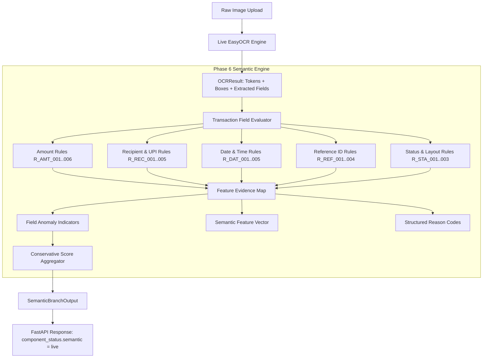

# Phase 6: Semantic Consistency Feature Engine

## 1. Overview & Objective

The **Semantic Consistency Feature Engine** (Phase 6) extracts structured, deterministic, auditable consistency signals from visible text tokens, spatial bounding boxes, and metadata extracted by the Phase 5 EasyOCR branch.

### Key Principles
1. **Deterministic & Rule-Based:** Evaluates explicit syntactical, chronological, and structural rules against OCR output. No black-box heuristic hallucination.
2. **Strict Evidence Provenance:** Every engineered feature records its origin, source OCR token, normalized bounding box, rule identifier (e.g. `R_AMT_003`), human-readable explanation, and native OCR confidence.
3. **Missing-Data Isolation:** Incomplete or occluded fields produce explicit status indicators (`not_available`, `is_missing = True`). **Missing data is never converted into evidence of tampering.**
4. **Decoupled Verdict:** Semantic consistency scores and anomaly indicators are completely decoupled from the CNN model. The CNN visual tampering verdict (`GENUINE` / `EDITED`) is never overridden by semantic analysis in Phase 6.
5. **No Banking Settlement Claims:** The engine analyzes visual and textual consistency rendered on the receipt screenshot. It does not verify bank-side ledgers, NPCI switches, or financial settlement.

---

## 2. Architecture & Data Flow



---

## 3. Semantic Rule Catalog

### Amount & Currency Rules

| Rule ID | Target Field | Validation Logic | Status Mapping | Reason Code |
| :--- | :--- | :--- | :--- | :--- |
| `R_AMT_001` | `amount_present` | Checks whether amount was localized. | `available` / `not_available` | - |
| `R_AMT_002` | `amount_parse_success` | Verifies clean numeric parse of decimal float. | `available` / `not_available` | - |
| `R_AMT_003` | `amount_valid_format` | Validates Indian currency grouping (`1,500.00`, `15,000`, `1,00,000.00`). | `available` / `invalid_format` | `AMOUNT_FORMAT_ANOMALY` |
| `R_AMT_004` | `amount_currency_symbol_valid` | Checks for Rupee symbol (`₹`) or accepted font indicator. | `available` / `invalid_format` | `AMOUNT_CURRENCY_SYMBOL_MISMATCH` |
| `R_AMT_005` | `amount_numeric_value_reasonable` | Verifies numeric range: $0 < \text{amount} \le 1,000,000$. | `available` / `invalid_format` | `AMOUNT_DECIMAL_ANOMALY` |
| `R_AMT_006` | `amount_conflicting_candidates` | Flags ambiguous competing numeric amounts in header area. | `ambiguous` | - |

### Recipient & UPI Rules

| Rule ID | Target Field | Validation Logic | Status Mapping | Reason Code |
| :--- | :--- | :--- | :--- | :--- |
| `R_REC_001` | `receiver_present` | Checks payee display name localization. | `available` / `not_available` | - |
| `R_REC_002` | `receiver_upi_present` | Checks payee VPA localization. | `available` / `not_available` | - |
| `R_REC_003` | `upi_handle_valid_format` | Validates RFC-like syntax: `^[a-zA-Z0-9.\-_]+@[a-zA-Z0-9]+$`. | `available` / `invalid_format` | `UPI_ID_SYNTAX_INVALID` |
| `R_REC_004` | `sender_receiver_distinct` | Verifies payee and payer names/VPAs are not identical. | `available` / `invalid_format` | `SENDER_RECEIVER_IDENTICAL` |
| `R_REC_005` | `conflicting_recipients` | Checks for multiple conflicting payee headers. | `ambiguous` | - |

### Date & Time Rules

| Rule ID | Target Field | Validation Logic | Status Mapping | Reason Code |
| :--- | :--- | :--- | :--- | :--- |
| `R_DAT_001` | `date_present` | Checks date string localization. | `available` / `not_available` | - |
| `R_DAT_002` | `time_present` | Checks time string localization. | `available` / `not_available` | - |
| `R_DAT_003` | `date_chronology_valid` | Validates calendar reality (days per month, leap year for Feb 29). | `available` / `invalid_format` | `TIMESTAMP_CHRONOLOGY_ANOMALY` |
| `R_DAT_004` | `time_format_valid` | Validates 12-hr (1..12 AM/PM) or 24-hr (0..23) and minutes (0..59). | `available` / `invalid_format` | `TIME_FORMAT_INVALID` |
| `R_DAT_005` | `conflicting_timestamps` | Flags multiple conflicting timestamp tokens in footer. | `ambiguous` | - |

### Transaction Reference Rules

| Rule ID | Target Field | Validation Logic | Status Mapping | Reason Code |
| :--- | :--- | :--- | :--- | :--- |
| `R_REF_001` | `ref_id_present` | Checks UPI Ref / UTR / Transaction ID localization. | `available` / `not_available` | - |
| `R_REF_002` | `ref_id_length_valid` | Standard UPI RRN must be exactly 12 digits (or synthetic `DEMO-UPI-X`). | `available` / `invalid_format` | `REF_ID_FORMAT_ANOMALY` |
| `R_REF_003` | `ref_id_numeric_only` | Standard 12-digit UPI RRN must contain only digits. | `available` / `invalid_format` | `REF_ID_FORMAT_ANOMALY` |
| `R_REF_004` | `google_txn_id_format` | Validates Google transaction format (`CIC...` or `DEMO-GPAY-...`). | `available` / `invalid_format` | - |

### Status & Layout Rules

| Rule ID | Target Field | Validation Logic | Status Mapping | Reason Code |
| :--- | :--- | :--- | :--- | :--- |
| `R_STA_001` | `status_present` | Checks status keyword localization. | `available` / `not_available` | - |
| `R_STA_002` | `status_text_authentic` | Must match known GPay lifecycle labels (`Paid`, `Completed`, `Payment to`). | `available` / `invalid_format` | `STATUS_TEXT_ANOMALY` |
| `R_LAY_001` | `gpay_keywords_present` | Checks for standard UI anchor keywords (`upi`, `google`, `to`, `from`). | `available` / `not_available` | - |
| `R_LAY_002` | `font_size_ratio` | Verifies amount header height $\ge$ payee name height. | `available` / `not_available` | - |
| `R_LAY_003` | `missing_critical_fields` | Counts missing fields among amount, receiver, status, and ref_id. | `available` | `MISSING_CRITICAL_PAYMENT_FIELD` |

---

## 4. Evidence Provenance Contract

Every evaluated feature produces a `SemanticFeatureEvidence` entry:

```python
class SemanticFeatureEvidence(BaseSchema):
    feature_name: str
    feature_value: Any
    feature_status: str  # "available", "not_available", "ambiguous", "invalid_format", "not_evaluated"
    source_ocr_text: Optional[str]
    source_bounding_box: Optional[NormalizedBoundingBox]
    rule_id: str
    explanation: str
    ocr_confidence: Optional[float]
    is_missing: bool
```

---

## 5. Scoring & Conservative Policy

- Active structural anomalies increment `semantic_manipulation_score`:
  - `date_anomaly` (impossible calendar date or invalid time): $+0.35$
  - `upi_handle_anomaly` (illegal VPA characters/syntax): $+0.35$
  - `ref_id_anomaly` (irregular RRN length or non-digits): $+0.30$
  - `status_anomaly` (non-authentic status text): $+0.30$
  - `amount_anomaly` (irregular currency grouping or missing symbol): $+0.20$
- **Total score is clamped to $[0.0, 1.0]$.**
- **Missing data adds $0.0$ to manipulation score.** Missing fields set `is_missing = True` and `feature_status = "not_available"`.

