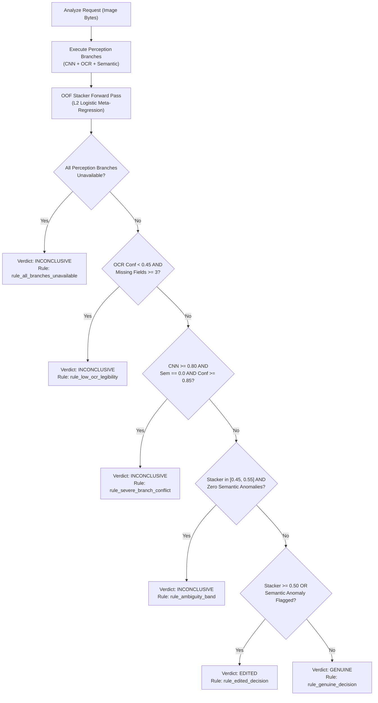

# CBL-04 — Phase 9: Final Verdict, Calibration & Evidence Documentation

## 1. Executive Summary

Phase 9 establishes the production decision engine for project **CBL-04: Google Pay Dark-Theme Transaction Screenshot Tampering Detection**. The service fuses perception signals from the ResNet-18 CNN branch, EasyOCR text extraction, Semantic Consistency heuristics, and the Phase 8 OOF Stacker into an explainable, auditable tripartite verdict:
- **`GENUINE`**: Consistent visual and semantic evidence supporting receipt authenticity within tested Google Pay templates.
- **`EDITED`**: Corroborated visual artifacts or explicit rule violations indicating digital fabrication or tampering.
- **`INCONCLUSIVE`**: Insufficient legible text, conflicting branch indicators, or ambiguous probabilities near the decision boundary.

---

## 2. Decision Logic & Safety Guardrails

The decision engine enforces strict guardrails against false certainty:



### Safety Guardrail Explanations

1. **Rule `rule_all_branches_unavailable`:** Triggered when network, memory, or model loading failures prevent both CNN and OCR branches from executing. Returns `INCONCLUSIVE` with neutral confidence $0.50$.
2. **Rule `rule_low_ocr_legibility`:** Triggered when image blur, heavy JPEG compression, or low contrast degrades OCR confidence below $0.45$ while $\ge 3$ critical fields (amount, recipient, reference ID, date) are undetected. Prevents misclassifying degraded authentic receipts as fraudulent.
3. **Rule `rule_severe_branch_conflict`:** Triggered when CNN visual perception predicts severe tampering ($\ge 0.80$), but the Semantic engine confirms $0.0$ manipulation with high OCR confidence ($\ge 0.85$) and zero field anomalies. Resolves irreconcilable branch disagreement as `INCONCLUSIVE`.
4. **Rule `rule_ambiguity_band`:** Evaluates an ambiguity margin of $\pm 0.05$ around the $0.50$ threshold. When $0.45 \le p_{\text{stacker}} \le 0.55$ in the absence of explicit rule violations, the decision is designated `INCONCLUSIVE`.
5. **Decisive `EDITED`:** Assigned when stacker score exceeds $0.50$ or explicit semantic rule violations (e.g., malformed currency symbol, invalid UPI handle suffix, impossible calendar date) are flagged.
6. **Decisive `GENUINE`:** Assigned when stacker score falls below $0.45$ and zero semantic anomalies are detected across all extracted fields.

---

## 3. Probability Calibration Assessment

Calibration evaluates whether a predicted probability $p$ matches the observed empirical frequency of positive cases:
- In CBL-04, the permitted validation partition contains exactly **108 samples** exclusively from the `bank_progress` layout family.
- Fitting parametric Platt scaling (logistic sigmoid) or non-parametric Isotonic Regression on 108 samples from a single layout family introduces extreme sample selection bias and overfits to layout-specific artifacts.
- **Formal Architectural Decision:** Manipulation probabilities are explicitly cataloged and exposed as **uncalibrated model scores** (`score_type: "raw_stacker_logistic_output"`, `calibration_status: "uncalibrated"`).
- The API explicitly warns downstream consumers that scores represent meta-model logistic activations rather than calibrated Bayesian posterior probabilities of legal fraud.

---

## 4. Explainable Evidence & Spatial Localization

For every decision, fine-grained provenance is preserved:
- **Semantic Evidence:** Attaches normalized bounding boxes (`box_normalized`), OCR text tokens, and human-readable rule explanations for any flagged field.
- **Localization Mask Disclaimer:** Spatial heatmap localization remains disabled due to low segmentation mask IoU ($0.059$ in Phase 7 baseline). Fabricating or rendering unreliable Grad-CAM heatmaps to users is strictly avoided.
- **Privacy Preservation:** Explanations report rule categories and field types without unnecessarily leaking sensitive fictional transaction amounts or account handles.
- **Settlement Disclaimer:** All API responses retain mandatory legal disclaimers stating that screenshot analysis examines visual and textual consistency only, and does not verify bank-side ledger settlement.

---

## 5. API Integration Schema

FastAPI endpoint `/api/v1/analyze` exposes the complete system state:
- `pipeline_status`: `"phase9_complete"`
- `component_status`:
  ```json
  {
    "cnn": "live",
    "ocr": "live",
    "semantic": "live",
    "stacker": "live",
    "verdict_engine": "live"
  }
  ```
- `verdict`: `"GENUINE"`, `"EDITED"`, or `"INCONCLUSIVE"` (mapped to `"REAL"`, `"FAKE"`, or `"INCONCLUSIVE"` when `verdict_style="frontend"`).
- `branch_scores`:
  ```json
  {
    "cnn_score": 0.2314,
    "semantic_score": 0.0,
    "stacker_score": 0.1845
  }
  ```

