# CBL-04: CNN Architecture and Preprocessing Comparison

**Auditing Entity:** Member 3 — Backend / AI Integration Lead  
**Audited Artifacts:**  
- `comparison_inputs/member2_cnn/Member 2/member2/phase5_model_training/model.py`  
- `comparison_inputs/member2_cnn/Member 2/member2/performance_improvement/models.py`  
- `comparison_inputs/member2_cnn/Member 2/member2/phase2_preprocessing/transforms.py`  
- `comparison_inputs/member2_cnn/Member 2/member2/performance_improvement/spatial_reconstructor.py`  
- `comparison_inputs/member2_cnn/Member 2/member2/performance_improvement/postprocessor.py`  
**Baseline Artifacts:**  
- `app/services/cnn_inference_service.py`  
- `Hackathon-VIT/CBL04-Dataset/scripts/phase7/model.py`  
**Date of Audit:** November 4, 2026  

---

## 1. Architectural Deep-Dive

We conducted a layer-by-layer architectural inspection and PyTorch state-dict analysis of all three models under comparison.

```mermaid
graph TD
    subgraph Member 3 Baseline
        M3_In["Full Screenshot (1080x2400)"] --> M3_Prep["Global Resize + Pad (320x160)"]
        M3_Prep --> M3_ResNet["ResNet-18 Backbone (Pretrained)"]
        M3_ResNet --> M3_ClsHead["Linear Cls Head (2 logits)"]
        M3_ResNet --> M3_MaskHead["ConvTranspose2d Mask Head (320x160)"]
    end

    subgraph Member 2 Phase 5
        M2_P5_In["Full Screenshot (1080x2400)"] --> M2_P5_Tiler["Sliding Window Tiling (256x256, s=128)"]
        M2_P5_Tiler --> M2_P5_Tiles["40-60 Tile Crops"]
        M2_P5_Tiles --> M2_P5_ResNet["TileResNet18 (From Scratch)"]
        M2_P5_ResNet --> M2_P5_Head["Linear Cls Head (2 logits per tile)"]
    end

    subgraph Member 2 Improvement
        M2_Imp_In["Full Screenshot (1080x2400)"] --> M2_Imp_Tiler["Sliding Window Tiling (256x256, s=128)"]
        M2_Imp_Tiler --> M2_Imp_Tiles["40-60 Tile Crops"]
        M2_Imp_Tiles --> M2_Imp_UNet["TileSpatialUNet (4-stage U-Net)"]
        M2_Imp_UNet --> M2_Imp_Maps["Spatial Logit Maps (1x256x256 per tile)"]
        M2_Imp_Maps --> M2_Imp_Recon["Gaussian 2D Weighted Blending"]
        M2_Imp_Recon --> M2_Imp_Post["Connected Component Filtering (>=50px)"]
    end
```



---

### 1.1 Structural Specification Table

| Attribute | Member 3 Baseline (`ResNet18MultiTask`) | Member 2 Phase 5 (`TileResNet18`) | Member 2 Improvement (`TileSpatialUNet`) |
| :--- | :--- | :--- | :--- |
| **Model Type** | Multi-Task Backbone + Dual Heads | Single-Task Tile Classifier | Fully Convolutional Segmentation U-Net |
| **Input Shape** | $(B, 3, 320, 160)$ | $(B, 3, 256, 256)$ | $(B, 3, 256, 256)$ |
| **Backbone Architecture** | ResNet-18 (Torchvision) | ResNet-18 (Torchvision) | 4-Stage Conv Encoder (16, 32, 64, 128) |
| **Pretrained Weights** | ImageNet-1k (`IMAGENET1K_V1`) | **None** (`pretrained=False`) | **None** (Trained from scratch) |
| **Decoder / Heads** | 1. `cls_head`: Linear(512, 2)<br>2. `mask_head`: 4-stage ConvTranspose2d | `backbone.fc`: Dropout(0.2) + Linear(512, 2) | 3-Stage ConvTranspose Decoder + $1 \times 1$ Conv Head |
| **Output Shapes** | 1. Logits: $(B, 2)$<br>2. Mask: $(B, 1, 320, 160)$ | Logits: $(B, 2)$ per tile | Spatial Map: $(B, 1, 256, 256)$ per tile |
| **Total Parameters** | 14,417,024 | 11,187,158 | 484,159 |
| **Trainable Tensors** | 122 state-dict tensors | 122 state-dict tensors | 38 state-dict tensors |
| **Checkpoint Storage** | 57.73 MB (`fold_1_resnet18_multitask.pt`) | 134.26 MB (contains Adam states) | 5.87 MB (`best_improved_model.pt`) |
| **Primary Task** | Whole-screenshot screening & coarse mask | Tile classification ($p_{\text{tampered}}$) | Fine-grained spatial pixel probability map |

---

### 1.2 Architectural Nuances & Insights

1. **Pretraining Discrepancy:**
   - Member 3's baseline utilizes ImageNet pretrained feature extractors. Even though downsampling degraded fine typography, low-level feature detectors (edges, gradients, textures) were pre-stabilized.
   - Member 2 explicitly configured `pretrained: false` in `training_config.json`. The ResNet-18 backbone was initialized with random Gaussian weights and trained for only 3 epochs on 1,500 tiles per epoch. This explains why `TileResNet18` struggled with generalized feature representations.

2. **The `TileSpatialUNet` Compactness:**
   - At only **484,159 parameters** (5.87 MB checkpoint), Member 2's `TileSpatialUNet` is remarkably lightweight (~30× smaller than ResNet-18).
   - Skip connections across its 3 downsampling stages (16, 32, 64 channels) allow fine spatial micro-features (font antialiasing boundaries and edge transitions) to bypass the bottleneck directly to the decoder.
   - However, because it lacks any fully connected or global pooling layer, it **cannot output a scalar image-level classification probability**.

---

## 2. Preprocessing & Input Pipeline Comparison

### 2.1 Dimensionality & Resolution Tracing

```
Raw Screenshot: 1080 x 2400 (Aspect Ratio: 1 : 2.22)
Total Raw Pixels: 2,592,000 pixels

Path A: Member 3 Global Downsampling (app/services/cnn_inference_service.py)
-------------------------------------------------------------------------
1. Aspect-preserving scale: min(160/1080, 320/2400) = min(0.1481, 0.1333) = 0.1333
2. Resized dimensions: 144 x 320 (LANCZOS resampling)
3. Canvas placement: Pasted at (0, 0) on 320 x 160 canvas with RGB (18, 18, 18) padding
4. Processed Canvas Area: 51,200 pixels
5. Information Compression Factor: 2,592,000 / 51,200 = 50.625x compression
-> Result: Micro-tampering affecting a 20x20 text box shrinks to ~2.6 x 2.6 pixels.

Path B: Member 2 Sliding Window Tiling (member2/phase3_tile_extraction/)
-----------------------------------------------------------------------
1. Scale: 1.0x (100% native unscaled pixels preserved)
2. Tile size: 256 x 256 pixels
3. Stride: 128 pixels (50% horizontal and vertical overlap)
4. Grid coordinates for 1080 x 2400:
   - X-coordinates: [0, 128, 256, 384, 512, 640, 768, 824] -> 8 columns
   - Y-coordinates: [0, 128, 256, ..., 2048, 2144] -> 18 rows
   - Boundary anchoring: Final column placed at x = 1080 - 256 = 824; final row at y = 2400 - 256 = 2144
5. Total tiles extracted: 8 x 18 = 144 crops (average across dataset: 43.5 tiles)
6. Information Compression Factor: 1.0x (Zero pixel loss)
-> Result: Character edges, anti-aliasing rings, and JPEG 8x8 block discontinuities remain fully intact.
```

---

### 2.2 Color Standardization & Padding Differences

| Feature | Member 3 Backend | Member 2 Pipeline | Integration Impact |
| :--- | :--- | :--- | :--- |
| **Dark Background Pad** | RGB `(18, 18, 18)` | RGB `(17, 17, 17)` (`#111111`) | Negligible ($\Delta = 1$ in pixel intensity) |
| **Alpha / RGBA Handling** | Stripped via `image.convert("RGB")` | Alpha-blended onto `#111111` canvas | Member 2 method avoids white fringe on transparent PNGs |
| **Normalization Mean** | `(0.485, 0.456, 0.406)` | `(0.485, 0.456, 0.406)` | Identical ImageNet standards |
| **Normalization Std** | `(0.229, 0.224, 0.225)` | `(0.229, 0.224, 0.225)` | Identical ImageNet standards |

---

## 3. Spatial Reconstruction & Post-Processing Pipeline

In Member 2's improved pipeline, individual $(1, 256, 256)$ tile predictions are reassembled into a single full-resolution continuous heatmap using **Spatial Gaussian Window Accumulation**:

### 3.1 2D Gaussian Window Formulation
Rather than averaging overlapping tiles with uniform weights (which introduces sharp grid boundaries), Member 2 weights each pixel $(x, y)$ in a $256 \times 256$ tile using an isotropic 2D Gaussian kernel centered at $(127.5, 127.5)$ with $\sigma = 64.0$:

$$w(x, y) = \exp\left(-\frac{(x - 127.5)^2 + (y - 127.5)^2}{2 \times 64.0^2}\right)$$

### 3.2 Canvas Reconstruction Equation
For a full-resolution canvas of dimensions $(H, W)$, two accumulator grids are allocated:
1. $A_{\text{prob}} \in \mathbb{R}^{H \times W}$ (weighted probability accumulator)
2. $A_{\text{weight}} \in \mathbb{R}^{H \times W}$ (spatial weight accumulator)

For each tile $k$ positioned at coordinates $(x_k, y_k)$:
$$A_{\text{prob}}(y_k : y_k + 256, x_k : x_k + 256) \mathrel{+}= P_k \odot w$$
$$A_{\text{weight}}(y_k : y_k + 256, x_k : x_k + 256) \mathrel{+}= w$$

The final de-biased continuous heatmap $H(x, y)$ is computed as:
$$H(x, y) = \frac{A_{\text{prob}}(x, y)}{A_{\text{weight}}(x, y) + 10^{-7}}$$

### 3.3 Connected Component Filtering
To eradicate isolated high-probability noise specks, the heatmap is post-processed via `HeatmapPostProcessor`:
1. **Thresholding:** $B(x, y) = \mathbb{I}(H(x, y) \ge 0.80)$.
2. **Connected Component Analysis:** Components in $B(x, y)$ are labeled using 8-connectivity (`scipy.ndimage.label`).
3. **Area Pruning:** Any component with pixel count $< A_{\min} = 50\text{ px}$ is pruned to zero.
4. **Result:** Preserves realistic text stroke edits (which typically span $100$ to $500$ connected pixels) while eliminating single-pixel antialiasing artifacts.

---

## 4. Training Methodology & Objective Functions

### 4.1 Loss Function Formulation

#### Member 3 Baseline:
$$\mathcal{L}_{\text{total}} = 0.7 \times \mathcal{L}_{\text{CE}}(\text{logits}, y_{\text{class}}) + 0.3 \times \mathcal{L}_{\text{BCE}}(\text{mask\_logits}, y_{\text{mask}})$$
- Balances classification and mask segmentation.
- However, BCE loss was overwhelmed by the $99.5\%$ negative background pixels in the downsampled canvas.

#### Member 2 Phase 5 (`TileResNet18`):
$$\mathcal{L}_{\text{Phase5}} = -\left[ w_0 \cdot (1 - y) \log(1 - p) + w_1 \cdot y \log(p) \right]$$
- Weights: $w_0 = 0.5423, w_1 = 6.4103$ (calculated from training split class imbalance).

#### Member 2 Improvement (`TileSpatialUNet`):
$$\mathcal{L}_{\text{Improved}} = 0.4 \times \mathcal{L}_{\text{BCE}}(\text{pos\_weight}=5.0) + 0.6 \times \mathcal{L}_{\text{SoftDice}}$$
$$\mathcal{L}_{\text{SoftDice}} = 1.0 - \frac{2 \sum_i (p_i \cdot y_i) + \epsilon}{\sum_i p_i + \sum_i y_i + \epsilon}$$
- This formulation directly maximizes pixel-level overlap (Dice/IoU) during backpropagation, yielding the massive 32× improvement in pixel localization.

---

## 5. Computational Complexity, Runtime & Latency Profile

We profiled the computational throughput of all three approaches on identical hardware (Mac CPU, Apple Silicon):

| Computational Characteristic | Member 3 Baseline | Member 2 Phase 5 | Member 2 Improvement (`TileSpatialUNet`) |
| :--- | :---: | :---: | :---: |
| **Inference Passes / Screenshot** | **1 forward pass** | **40 – 60 tile passes** | **40 – 60 tile passes** |
| **Batched Forward Execution** | Single tensor $(1, 3, 320, 160)$ | Batched tiles $(16, 3, 256, 256)$ | Batched tiles $(16, 3, 256, 256)$ |
| **Post-Processing Overhead** | Simple sigmoid + argmax | Min/Max/Mean tile aggregation | Gaussian window blending + `scipy` labeling |
| **CPU Inference Latency** | **~15 ms** | **~850 ms** | **~1,800 – 3,200 ms** |
| **Throughput (Images / sec)** | **~66.7 img/sec** | **~1.18 img/sec** | **~0.35 – 0.55 img/sec** |
| **Peak Memory Consumption** | **~62 MB** | **~185 MB** | **~240 MB** (accumulators) |
| **Real-Time API Suitability** | **EXCELLENT** ($<50$ ms) | **POOR** ($>800$ ms) | **UNSUITABLE FOR SYNC API** ($>2.5$ s) |

**Conclusion:** Member 3's inference pipeline is **over 120× faster** than Member 2's spatial tiling pipeline. While Member 2's localization quality is vastly superior, its runtime profile makes it unsuitable for synchronous request-response loops in a high-throughput payment verification backend without asynchronous job delegation.

