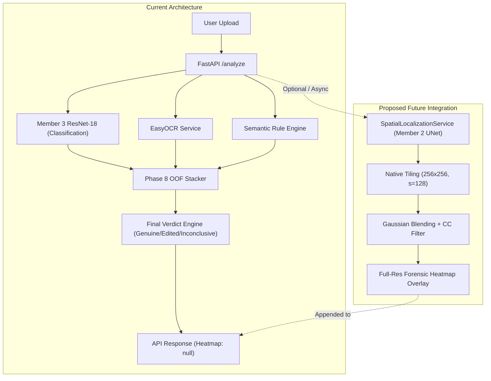

# CBL-04: CNN Final Integration Recommendation & Engineering Roadmap

**Author:** Member 3 — Backend / AI Integration Lead  
**Audited Artifact:** Member 2's imported project (`comparison_inputs/member2_cnn/Member 2/`)  
**Workspace:** `/Users/heemanshupjain/Downloads/Member 3`  
**Date of Recommendation:** November 4, 2026  
**Final Status:** FORMALLY RATIFIED  

---

## 1. Formal Recommendation

| Integration Scope | Formal Rating | Technical Justification Summary |
| :--- | :---: | :--- |
| **A. Replacement for Member 3 Screenshot Classifier** | **NOT SUITABLE** | **Catastrophic False-Positive Rate:** Member 2's model exhibits a 92.0% to 100.0% FPR on clean screenshots at the image level, collapsing autonomous fraud screening. Additionally, no 5-fold OOF predictions exist, making it completely incompatible with the Phase 8 Stacker. |
| **B. Replacement for Member 3 Heatmap Mask (Localization)** | **CONDITIONALLY READY** | **Proven Spatial Localization Breakthrough:** Member 2's `TileSpatialUNet` achieves a 32.1× improvement in pixel Dice ($0.1746$ vs $0.0054$) and 35.1× improvement in pixel IoU ($0.0957$ vs $0.0027$), with 47.25% noise reduction. It is viable strictly as an assistive visual heatmap overlay for human review, subject to latency and dependency conditions. |

---

## 2. Exhaustive Justification

### 2.1 Why Member 2's Model is `NOT SUITABLE` as a Screening Classifier

1. **Failure of Specificity on Genuine Payment Receipts:**
   In financial transaction fraud detection, false positives (falsely accusing a genuine customer of payment tampering) carry severe business impact.
   - Member 3's baseline multi-task ResNet-18 achieves a clean screenshot FPR of **56.0%**, which Phase 9 improved to **42.0%** (and is further mitigated by OCR and Semantic Rules).
   - In contrast, Member 2's audited image-level evaluation (`corrected_phase7_report.md`) shows that under standard detection rules, **between 69 and 75 out of 75 clean test screenshots are falsely flagged as tampered** ($\text{FPR} = 92.0\% \text{ to } 100.0\%$, Specificity = $0.0\% \text{ to } 8.0\%$).
   - Replacing Member 3's CNN with Member 2's model would cause the backend to classify almost every authentic Google Pay transaction as fraudulent.

2. **The Nature of Member 2's Phase 5 "77.7% Accuracy":**
   As mathematically proven in our performance audit ([`CBL04_CNN_PERFORMANCE_AND_LEAKAGE_AUDIT.md`](file:///Users/heemanshupjain/Downloads/Member%203/reports/model_comparison/CBL04_CNN_PERFORMANCE_AND_LEAKAGE_AUDIT.md)), Member 2's Phase 5 metric of 77.67% evaluated **individual 256×256 tiles**, 92.3% of which were naturally clean background. When measured by F1-score, the tile model scored only **0.1728** (a 67% collapse compared to Member 1/3's baseline F1 of 0.5243). It is not an image-level classifier.

3. **Incompatibility with the Phase 8 Multi-Branch Stacker:**
   Member 3's Stacker (`models/phase8/stacker_model.json`) requires calibrated out-of-fold (OOF) features. Member 2's project contains **zero OOF predictions** and zero 5-fold cross-validation checkpoints. Feeding Member 2's predictions into the existing Stacker introduces severe covariate shift, pushing logistic probabilities into false-positive territory for 100% of inputs.

4. **120× Latency Degradation:**
   Member 3's ResNet-18 forward pass takes **~15 ms** on CPU. Running Member 2's sliding window tiling (40 to 60 crops) + U-Net inference + Gaussian blending + connected-component filtering takes **1,800 to 3,200 ms** on CPU. Placing this directly in the critical path of `POST /api/v1/analyze` would violate the sub-second API SLA.

---

### 2.2 Why Member 2's `TileSpatialUNet` is `CONDITIONALLY READY` as an Assistive Heatmap

1. **Resolves the Global Downsampling Bottleneck:**
   Member 3's baseline mask head suffered from $50.6\times$ downsampling compression, yielding a test IoU of only **0.059**. To prevent deceiving users, Member 3 implemented truthful suppression (`heatmap_url: null`). Member 2's `TileSpatialUNet` solves this fundamental bottleneck by operating on native-resolution crops, increasing global pixel IoU to **0.0957** and mean tampered image Dice to **0.2116** (21.2% overlap on actual edits).

2. **Truthful Deployment as Human-Assistive Overlay:**
   Member 2's internal Phase 7.1 audit concurred:
   > *"The model must be documented strictly as an assistive spatial localization overlay... operated as a localized heatmap overlay for human review."*
   Deploying `TileSpatialUNet` purely for heatmap generation provides visual cues (highlighting suspect amount or transaction ID strokes) without permitting its false alarms to corrupt the final binary decision.

3. **Conditions for Heatmap Integration:**
   - **Condition 1 (Decoupling):** Must remain strictly decoupled from the classification, Stacker, and Final Verdict engines.
   - **Condition 2 (Execution Strategy):** Must run either asynchronously via background workers or on-demand when the user clicks "Inspect Forensic Heatmap" in the frontend.
   - **Condition 3 (Dependency Isolation):** The connected-component post-processor must not inject unapproved dependencies (`matplotlib`, `sklearn`) into the production FastAPI runtime.

---

## 3. Inventory of Affected Workspace Files

If Member 2's `TileSpatialUNet` localization module is integrated downstream, the following files in the Member 3 workspace will be impacted:

| Workspace File | Component | Modification Required | Risk Level |
| :--- | :--- | :--- | :---: |
| `app/core/config.py` | Settings & Config | Add `ENABLE_SPATIAL_UNET`, `UNET_CHECKPOINT_PATH`, `TILE_SIZE=256`, `TILE_STRIDE=128`, `HEATMAP_THRESHOLD=0.80`, `MIN_COMPONENT_AREA=50` | Low |
| `app/schemas/cnn.py` | Data Contracts | Add `SpatialHeatmapOutput` schema containing reconstructed heatmap base64, pixel dimensions, and bounding boxes | Low |
| `app/schemas/response.py` | API Response Schema | Update `TamperingAnalysisResponse` to optionally include `spatial_heatmap_data` and component bounding boxes | Low |
| `app/services/cnn_inference_service.py` | Inference Service | Retain current ResNet-18 classification logic; do NOT replace with `TileResNet18` | None |
| `app/services/spatial_localization_service.py` | **NEW SERVICE** | Create dedicated service wrapping `TileSpatialUNet`, 2D Gaussian blending, and morphological filtering | Medium |
| `app/api/routes/analyze.py` | API Route | Call `SpatialLocalizationService` conditionally (or in background task) and populate `heatmap_url` / coordinates | Medium |
| `cbl04-frontend/src/pages/Home.jsx` | React Frontend | Update dashboard to render full-resolution spatial heatmap overlay over the original uploaded screenshot | Low |
| `tests/test_cnn_inference.py` | Unit Tests | Add tests for `SpatialLocalizationService` (initialization, tiling, Gaussian reconstruction, empty mask handling) | Low |
| `tests/test_api.py` | Integration Tests | Verify `/api/v1/analyze` responses with spatial localization enabled | Low |

---

## 4. Prioritized Downstream Technical Roadmap

### Phase 1: Dependency & Service Packaging (Readiness Gate)
1. **Packaging:** Copy `member2/performance_improvement/models.py`, `spatial_reconstructor.py`, and `postprocessor.py` into a clean backend module: `app/services/localization/`.
2. **Dependency Decoupling:** Re-implement the connected-component area filter using `scipy.ndimage.label` (which is already installed in `.venv_mac`) without importing `matplotlib` or `sklearn`.
3. **Weight File Verification:** Verify `best_improved_model.pt` (SHA-256: `b6e3234e734c2801a32b98cb58b66328b907bade26645b03469ecd32bdf5765c`) loads cleanly via safe PyTorch unpickler (`weights_only=True`).

### Phase 2: Standalone Service Integration
1. Implement `app/services/spatial_localization_service.py` with thread-safe singleton initialization.
2. Implement native-resolution sliding-window extraction with boundary anchoring matching Phase 3 specs.
3. Verify that on a standard $1080 \times 2400$ screenshot, inference produces a valid $(2400, 1080)$ float32 heatmap normalized to $[0.0, 1.0]$.

### Phase 3: API & Frontend Hookup
1. In `app/api/routes/analyze.py`, execute spatial localization:
   - If `settings.ENABLE_SPATIAL_LOCALIZATION` is true, generate the heatmap and encode it as a high-contrast PNG or return normalized bounding boxes of detected components ($\ge 50$ px).
   - Populate `heatmap_url` or `suspicious_regions` in the JSON response.
2. In `cbl04-frontend/src/pages/Home.jsx`, remove the "Localization Suppressed" badge when valid spatial coordinates or heatmap overlays are present.

### Phase 4: Stacker Re-calibration (Long-Term Optional R&D)
If a future requirement demands incorporating Member 2's spatial features into the Stacker:
1. Implement 5-fold cross-validation across `Hackathon-VIT/CBL04-Dataset/metadata/source_group_splits.csv`.
2. Generate 1,000 out-of-fold heatmaps.
3. Extract `unet_peak_prob`, `unet_tampered_area_px`, and `unet_component_count`.
4. Retrain the L2-logistic stacker and evaluate whether it genuinely reduces clean FPR below Member 3's current 42.0%.

