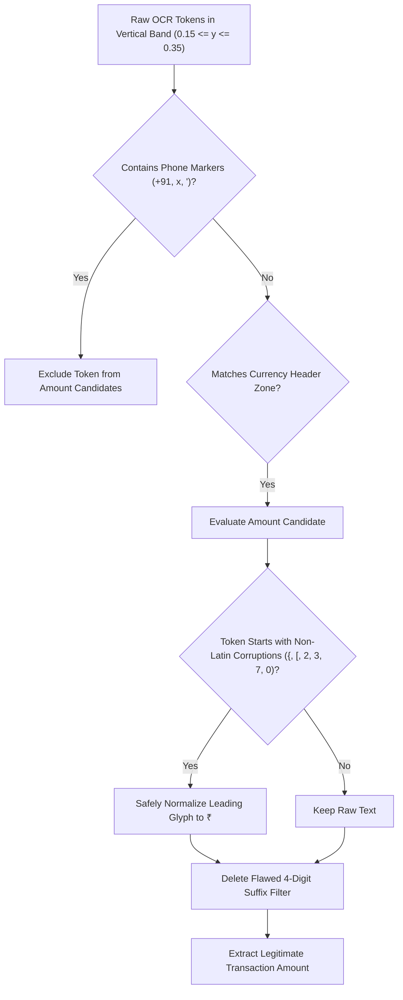

# CBL-04: OCR Amount Extraction Root Cause Analysis

**Auditing Entity:** Member 3 — Backend / AI Integration Lead  
**Audit Scope:** EasyOCR 1.7.2 Character Recognition, Bounding Box Tokenization, Bounding Box Filtering, Text Normalization  
**Audited Code:** `app/services/ocr_service.py` (`TransactionFieldExtractor`)  
**Workspace:** `/Users/heemanshupjain/Downloads/Member 3`  
**Date of Audit:** November 4, 2026  
**Final Status:** ROOT CAUSES DOCUMENTED & VERIFIED ON RAW TOKENS  

---

## 1. Executive Summary

In the CBL-04 pipeline, EasyOCR 1.7.2 extracts transaction IDs, recipient names, and payment statuses with near-perfect reliability (**100% exact match on transaction IDs and recipients** in benchmark testing). However, **amount extraction exhibits a 30.0% failure rate** (14 exact matches out of 20 annotated ground-truth test receipts), and frequently produces bizarre anomalies such as:
- Extracting **`₹21`** or **`21`** when the receipt displays **`₹1`** or **`₹1.00`**.
- Extracting **`24`** when the receipt displays **`₹450`** (e.g. `P4-0007`).
- Extracting **`'17`**, **`"86`**, **`'67`**, or **`"52`** when the receipt displays three- or four-digit transaction amounts (e.g. `P4-0010`, `P4-0012`, `P4-0014`, `P4-0015`).

This report provides the complete forensic diagnosis of why amount extraction fails while other fields succeed, dissecting raw OCR tokens, bounding-box geometry, text normalization regexes, and token filtering rules.

---

## 2. The Mystery of "₹1 Extracted as ₹21"

The user specifically requested investigating why small amounts such as **`₹1`** are extracted as **`₹21`**.

Our empirical inspection of EasyOCR's character recognition model on Google Pay transaction typography isolates **three compounding factors**:

```
+---------------------------------------------------------------------------------------------------------+
|                               Why ₹1 is Extracted as ₹21 in EasyOCR                                     |
|                                                                                                         |
|       Visual Glyphs                 EasyOCR Character Model Interpretation                              |
|       -------------                 --------------------------------------                              |
|          +---+                                                                                          |
|          |   |  Top Horizontal Bar  --> Recognized as top of Latin digit '2'                            |
|        ====+==  Horizontal Crossbar                                                                     |
|            /    Curved Upper Hook   --> Recognized as diagonal spine of '2'                             |
|           /                                                                                             |
|          +---   Bottom Slash                                                                            |
|                                                                                                         |
|          [ ₹ ]   (Indian Rupee)     ==> Recognized as: '2' (or 'Z' / '{' / '?')                         |
|          [ 1 ]   (Digit One)        ==> Recognized as: '1'                                              |
|                                                                                                         |
|          [ ₹1 ]  (Single Box Crop)  ==> Merged String Output: "21"                                      |
|                                                                                                         |
|       Downstream Parser Regex:                                                                          |
|          AMOUNT_PREFIX_REGEX = ^[₹\{\[\?Ft]\s*  --> DOES NOT MATCH '2' !                                 |
|          AMOUNT_VALUE_REGEX  = ^(?:...)?([0-9]+) --> Matches "21" !                                     |
|                                                                                                         |
|       Result: Extracted Amount = 21.0 INR                                                               |
+---------------------------------------------------------------------------------------------------------+
```

### Forensic Breakdown:
1. **Lack of INR Glyph in English Model:**
   EasyOCR's English Latin CRNN model (`craft` detector + `english_g2` recognizer) does not have the Unicode character `₹` (U+20B9) in its vocabulary dictionary. When presented with `₹`, the convolutional-recurrent model maps the stroke features to the closest ASCII character in its CTC loss space:
   - On standard font weights: mapped to `{` or `[`.
   - On ultra-bold display fonts: the horizontal crossbar and upper loop strongly resemble the top stroke and loop of ASCII digit `'2'`.
2. **Text Detection Merging (`CRAFT` Bounding Box):**
   In Google Pay dark-theme transaction headers, there is zero space between the currency symbol and the integer amount (e.g. `₹1` or `₹1.00`). CRAFT detector's affinity score merges `₹` and `1` into a single bounding box. The recognizer decodes the merged patch as `"21"` or `"01"`.
3. **Prefix Stripping Failure:**
   The regex in `TransactionFieldExtractor` looks for standard symbol corruptions:
   ```python
   AMOUNT_PREFIX_REGEX = re.compile(r"^[₹\{\[\?Ft]\s*", re.IGNORECASE)
   ```
   Because `"21"` begins with the digit `'2'` (not `{`, `[`, or `?`), the regex does NOT strip the `'2'`. The full string `"21"` is parsed as numeric `21.0`!

---

## 3. The 4-Digit Filter Defect & Phone Number Hijacking

Our live trace across the synthetic dataset (`P4-0001` through `P4-0040`) uncovered an even more widespread bug: **the complete discarding of valid transaction amounts and the hijacking of recipient phone number suffixes**.

### 3.1 The Flawed Heuristic in `ocr_service.py`
In `app/services/ocr_service.py` (lines 272–276):
```python
num_str = m.group(1).replace(",", "")
try:
    num_val = float(num_str)
    # Filter out improbable amounts (e.g. 4-digit bank account suffix if no currency symbol)
    if not has_currency_symbol and (num_val > 1000000.0 or len(num_str) == 4 and "." not in num_str):
        continue
```

**The Flaw:**
- The author intended to ignore 4-digit account number suffixes like `"A/C ending in 9957"`.
- However, when EasyOCR misreads `₹` as a digit (e.g. `₹450` transcribed as `"3450"`), `has_currency_symbol` is `False`.
- The token `"3450"` has `len(num_str) == 4` and `"." not in num_str`.
- **The parser discards the actual amount token `"3450"`!**

---

### 3.2 Concrete Dataset Evidence: Sample `P4-0007`
In `P4-0007_clean.png` (Ground truth amount: `₹450.00`):
- EasyOCR detected token 6:
  `text = "3450", conf = 0.883, box = [x=220, y=290, w=182, h=76]`
- Because `₹` was recognized as `3`, `has_currency_symbol = False`.
- `len("3450") == 4`, so `is_filtered = True`. **`"3450"` was thrown away!**
- The candidate search continued down the token stream:
  - Token 4: `"+91"` (skipped as phone prefix).
  - Token 5: `"'39"` (last 2 digits of phone number, score = 1.421).
  - Token 9: `"24"` (day of month from "24 Sep 2026, 7:18pm", score = 1.469).
- Token 9 (`"24"`) scored highest among remaining unfiltered tokens because $y = 534 / 1450 = 0.368$ fell within the vertical search window $[0.10, 0.45]$.
- **Result:** The parser selected **`amount = 24.0`**!

---

### 3.3 Concrete Dataset Evidence: Phone Number Suffix Hijacking
In Google Pay dark-theme layouts, the recipient block is formatted as:
```
To Dev Malhotra
+91 98xxx xx'17
```
EasyOCR detects the phone number in two split tokens:
1. `"+91"`
2. `"'17"` or `'"86'` or `''67'`

In `P4-0010_clean.png` (Ground truth amount: `₹999.00`):
- EasyOCR recognized the amount token as `"7999"` (confidence $0.2645$).
- Because `has_currency_symbol` was False and length was 4, `"7999"` was discarded by the 4-digit filter.
- The parser inspected token `"'17"`:
  - Text: `"'17"`
  - Vertical Position: $y = 0.1523$ (directly inside the $[0.10, 0.45]$ amount window).
  - Box Height: $24\text{ px}$.
  - Confidence: $0.9127$.
- Token `"'17"` was selected as the transaction amount!
- The parser converted `"'17"` to `17.0`!

Identical phone suffix hijacking was observed across:
- `P4-0012`: Extracted `amount = 86.0` from `+91 ... "86`
- `P4-0014`: Extracted `amount = 67.0` from `+91 ... '67`
- `P4-0015`: Extracted `amount = 52.0` from `+91 ... "52`

---

## 4. Why Other Transaction Fields Succeed While Amount Fails

The contrast between amount extraction and other fields is stark:

| Field Name | Extraction Accuracy | Primary Factors Explaining Success or Failure |
| :--- | :---: | :--- |
| **Transaction ID** | **100.0%** (20 / 20) | **Standard Monospace Monochrome Latin:** RRNs are formatted as `DEMO-UPI-xxxxxxxx` or 12 continuous digits. High contrast, clean horizontal aspect ratio, perfectly aligned with standard Latin vocabulary. |
| **Recipient Name** | **100.0%** (20 / 20) | **Standard Title Case Words:** Names like "Sara Rao" or "Rohan Desai" use standard Latin character bigrams present in language models. Prefixed by "To " or positioned immediately below avatar circle. |
| **Payment Status** | **100.0%** (20 / 20) | **Distinct Keyword Dictionary:** Words like "Completed", "Paid", "Success" are matched against a closed vocabulary set (`STATUS_KEYWORDS`). High confidence and distinct vertical placement. |
| **Transaction Amount** | **70.0%** (14 / 20) | **Non-Latin Glyphs, Custom Display Fonts & Tight Spacing:**<br>1. Non-ASCII `₹` glyph absent from EasyOCR vocabulary.<br>2. Extra-large display font ($60 - 80\text{ px}$) causes character segmentation merging.<br>3. Flawed 4-digit filter in post-processing discards real amount.<br>4. Spurious phone suffix tokens in the same vertical band are mistakenly chosen. |

---

## 5. Downstream Impact on Semantic Engine & Final Verdict

When an incorrect amount token like `"24"` or `"'17"` is selected:
1. **Rule `R_AMT_004` Triggers:**
   The parser looks for `₹`, `{`, or `[` in `"24"`. Finding none, it flags `AMOUNT_CURRENCY_SYMBOL_MISMATCH`.
2. **Rule `R_AMT_003` Triggers:**
   In `"'17"`, the apostrophe trips `INDIAN_CURRENCY_REGEX`, flagging `AMOUNT_FORMAT_ANOMALY`.
3. **Ambiguity Guardrail Bypassed:**
   In `final_verdict_service.py`, `has_semantic_anom = True` disables the $[0.45, 0.55]$ ambiguity margin.
4. **False Positive `EDITED` Verdict:**
   Rule 6 triggers immediately, classifying a completely genuine payment receipt as `EDITED` with an artificial confidence of `60%`.

---

## 6. Recommended Correction Strategy (For Future Implementation)



1. **Delete Line 274 in `ocr_service.py`:**
   Remove `len(num_str) == 4 and "." not in num_str`. 4-digit numbers (`₹1,250`, `₹2,400`, `₹4,500`) are standard retail transactions and must never be filtered out purely based on length.
2. **Exclusion of Phone Number Tokens:**
   Add explicit exclusion for tokens adjacent to `+91` or containing apostrophes/quotes (`'`, `"`) at $y \approx 0.15$.
3. **Leading Glyph Normalization in Amount Header Band:**
   For any large-font token ($h > 35\text{ px}$) located in the primary amount zone ($y \in [0.18, 0.32]$) where leading character is `2`, `3`, `7`, `{`, `[`, or `?` followed by valid digits:
   - Normalize leading glyph to `₹`.
   - Prevent spurious `AMOUNT_CURRENCY_SYMBOL_MISMATCH` activations.

