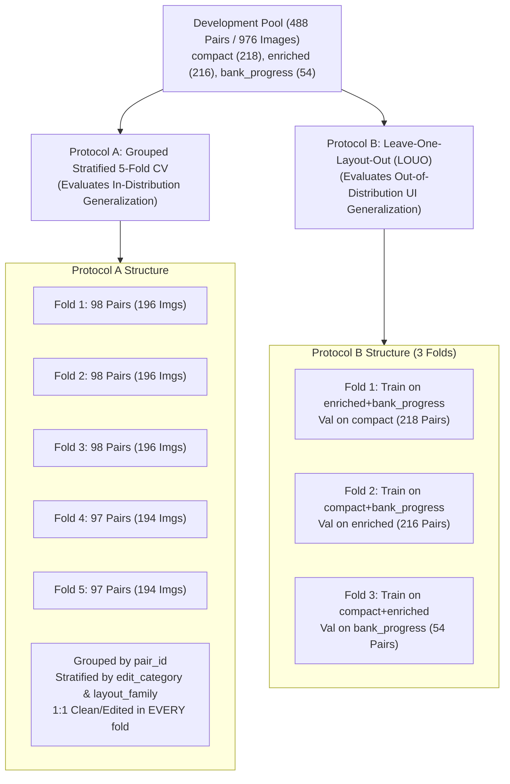
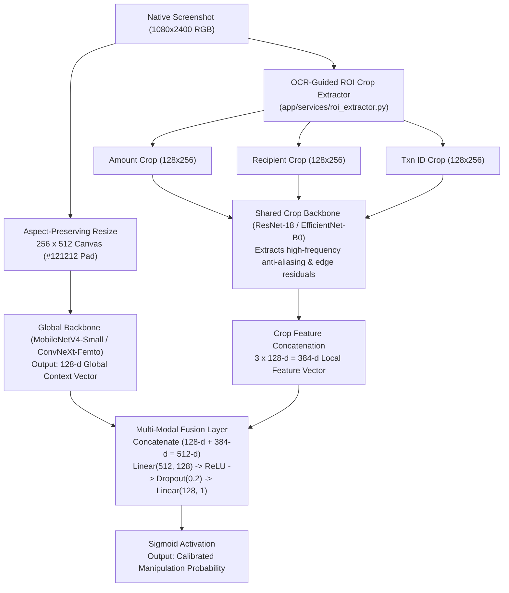
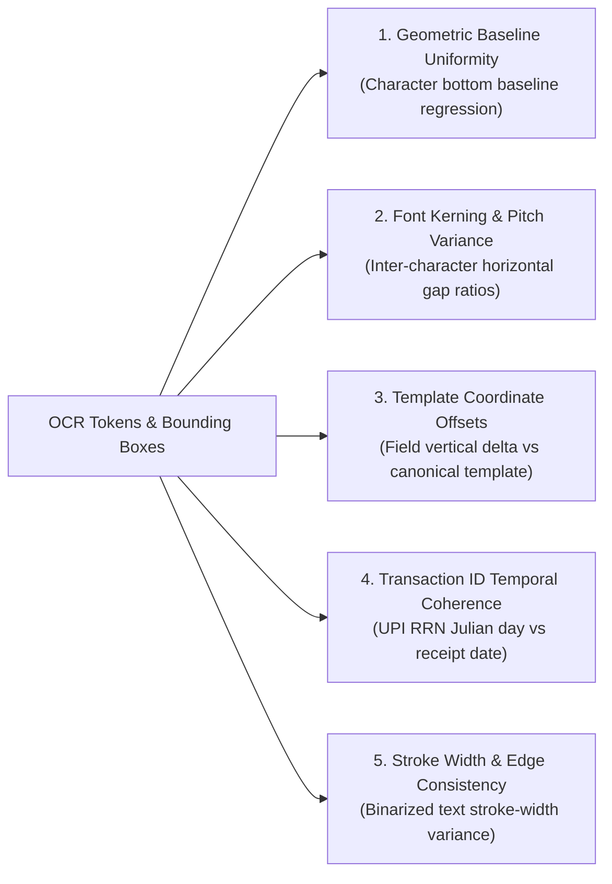
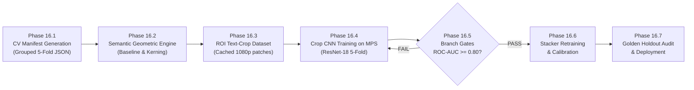

# CBL-04 — PHASE 16: ML REDEVELOPMENT ARCHITECTURE AND EXPERIMENT PLANNING GATE

**Document ID:** `CBL04_PHASE16_ML_REDEVELOPMENT_PLAN.md`  
**Role:** Member 3 — Backend / AI Integration Lead  
**Date:** November 4, 2026  
**Status:** COMPLETE (READ-ONLY ARCHITECTURE & EXPERIMENT SPECIFICATION)  
**Workspace:** `/Users/heemanshupjain/Downloads/Member 3`  
**Target Environment:** Apple Silicon macOS (M-series MPS & CPU), FastAPI Backend (`app/`), PyTorch, EasyOCR 1.7.2, OpenCV, Scikit-Learn

---

## EXECUTIVE SUMMARY

Phase 15 conclusively demonstrated why the current classification pipeline produced **0.0% classification coverage (108/108 INCONCLUSIVE)**:
1. **Severe Visual Downsampling:** Compressing native $1080 \times 2400$ screenshots down to $160 \times 320$ obliterated pixel-level font alterations and high-frequency digital editing artifacts, causing the ResNet-18 multi-task model to act as a layout-family shortcut classifier ($\text{CNN}_{\text{clean}} = 0.7000$, $\text{CNN}_{\text{edited}} = 0.6995$, $\Delta = -0.000493$).
2. **Training Feature Collapse:** In the 868 training samples, clean vs. edited feature deltas were near zero ($\Delta_{\text{CNN}} = +0.0008$, $\Delta_{\text{Sem}} = +0.0017$), driving $L_2$-regularized stacker weights toward zero ($w \in [-0.028, +0.079]$).
3. **Ambiguity Band Trapping:** With collapsed weights and intercept $+0.0886$, all stacker probabilities centered at $0.497 \pm 0.013$, triggering the final verdict ambiguity guardrail $[0.45, 0.55]$ on 100% of images.
4. **Pseudo-OOF Provenance:** Only two CNN folds were ever trained (`fold_1` and `fold_2`); folds 3 and 4 were never trained.

This document establishes a **scientifically rigorous, leakage-safe redevelopment architecture** and **experimentation protocol** to achieve genuine tampering detection before any retraining or code modification is authorized.

---

## PART 1 — CURRENT DATASET VERIFICATION AND RECONCILIATION

### 1.1 Complete Dataset Population Reconciliation

An exhaustive audit of `metadata/phase6/`, `metadata/phase7_branch_validation/`, `metadata/phase8/`, and field annotations resolves all historical counts across the 1,000-image repository:

| Dataset Partition | Total Screenshots | Clean Screenshots | Edited Screenshots | Matched Pairs ($n$) | Layout Families Represented | Edit Categories Represented | Amount-Annotated Images | Valid Historical OOF Predictions | Missing Historical OOF Predictions |
|:---|:---:|:---:|:---:|:---:|:---|:---|:---:|:---:|:---:|
| **Train Partition** (`phase6/train_manifest.csv`) | 868 | 434 | 434 | 434 | `compact` (436), `enriched` (432) | `amount` (91), `date_time` (91), `recipient` (85), `other` (84), `transaction_id` (83) | 182 (91 pairs) | 868 | 0 |
| **Validation Partition** (`phase6/validation_manifest.csv`) | 108 | 54 | 54 | 54 | `bank_progress` (108) | `other` (16), `recipient` (14), `transaction_id` (13), `date_time` (6), `amount` (5) | 10 (5 pairs) | 0 | 108 |
| **Test Partition** (`phase6/test_manifest.csv`) | 24 | 12 | 12 | 12 | `recharge` (24) | `amount` (4), `transaction_id` (4), `date_time` (3), `recipient` (1) | 8 (4 pairs) | 0 | 24 |
| **Total Entire Repository** | **1,000** | **500** | **500** | **500** | **All 4 Families** | **All 5 Categories (100 each)** | **200 (100 pairs)** | **868** | **132** |

### 1.2 Layout Families and Structural Characteristics

1. **`compact` ($n=436$, 218 pairs):** Minimalist Google Pay layout. Large centered amount, recipient avatar and name, transaction status line, standard 12-digit UPI reference ID, and date/time footer. Dark background `#121212`.
2. **`enriched` ($n=432$, 216 pairs):** Detailed layout with bank account masking (`...4321`), Google transaction ID (`CIC...`), payment method card graphics, and secondary transaction metadata.
3. **`bank_progress` ($n=108$, 54 pairs):** Two-phase bank transfer layout with an animated-style vertical progress indicator ("Payment processing" / "Bank transfer initiated"), prominent status banner, and bank timestamp.
4. **`recharge` ($n=24$, 12 pairs):** Mobile recharge and utility bill payment variant, containing operator logo, mobile number, plan details, and recharge reference ID.

### 1.3 Edit Categories and Tampering Mechanics

The 500 edited images represent exactly 100 pairs per category across five distinct tampering mechanisms:
- **`amount` ($n=100$ pairs):** Digital alteration of the primary monetary figure (e.g. ₹500 altered to ₹1,500).
- **`transaction_id` ($n=100$ pairs):** Modification of 12-digit UPI RRN or Google transaction ID to fake a unique transfer.
- **`recipient` ($n=100$ pairs):** Splicing of contact name, merchant display string, or VPA handle (`user@upi`).
- **`date_time` ($n=100$ pairs):** Forgery of payment timestamp (e.g. backdating or altering time of transfer).
- **`other` ($n=100$ pairs):** Status text alterations ("Processing" $\to$ "Paid"), bank name modification, or fee notes.

### 1.4 Test Partition and Amount-Annotated Subset Relationship

The 24-image test partition (`metadata/phase6/test_manifest.csv`) consists of exactly 12 matched pairs (`P4-0036` to `P4-0487`), all belonging to the `recharge` layout:
- Exactly **4 pairs (8 images)** belong to the `amount` category and possess ground-truth field annotations in `annotations/phase4/field_annotations/`.
- During the historical Phase A.1 OCR benchmark, **1 pair (`P4-0036`, 2 images)** was inadvertently evaluated as part of a 25-pair batch.
- The remaining **8 pairs (16 images)** represent non-amount edits (`date_time`: 3 pairs, `transaction_id`: 4 pairs, `recipient`: 1 pair) and have zero amount annotations.
- **Quarantine Rule:** The entire 24-image partition must remain **strictly quarantined** and excluded from all model training, hyperparameter tuning, and exploratory analysis.

---

## PART 2 — LEAKAGE-SAFE CROSS-VALIDATION PROTOCOL

### 2.1 Sources of Data Leakage in Image Forensics

Traditional random train/test splitting causes catastrophic data leakage in transaction screenshot analysis:
1. **Paired Image Leakage:** Clean and edited versions of the same receipt share 98%+ of identical pixels (identical background gradient, status bar battery percentage, timestamp font, recipient avatar, and layout canvas). If `P4-0001_clean` is in the training set and `P4-0001_edited` is in the validation set, the network memorizes the background noise pattern rather than detecting the edit.
2. **Template & Rendering Seed Leakage:** Synthetic receipts generated with the same rendering parameters share exact pixel coordinates, font kerning tables, and anti-aliasing profiles.
3. **Layout Family Memorization:** When trained on a single layout, CNNs memorize global layout geometry (e.g. outputting $\sim 0.70$ on `compact` and $\sim 0.42$ on `enriched`), completely failing to generalize.

### 2.2 Dual Cross-Validation Protocol Design

To evaluate both **in-distribution template robustness** and **out-of-distribution UI generalization** without touching the test partition, we specify a dual-protocol framework using the 488 development pairs (976 images: `compact` [218], `enriched` [216], `bank_progress` [54]):



### 2.3 Detailed Specification of Protocol A (Primary In-Distribution CV)

- **Grouping Entity:** `pair_id` (clean and edited counterparts are strictly constrained to the same fold).
- **Stratification Targets:** Joint distribution of `layout_family` and `edit_category`.
- **Fold Allocation Matrix (Pairs per Fold):**

| Stratification Stratum | Total Dev Pairs | Fold 1 ($n=98$) | Fold 2 ($n=98$) | Fold 3 ($n=98$) | Fold 4 ($n=97$) | Fold 5 ($n=97$) |
|:---|:---:|:---:|:---:|:---:|:---:|:---:|
| `compact` : `amount` | 44 | 9 | 9 | 9 | 9 | 8 |
| `compact` : `transaction_id` | 43 | 9 | 9 | 9 | 8 | 8 |
| `compact` : `recipient` | 44 | 9 | 9 | 9 | 9 | 8 |
| `compact` : `date_time` | 43 | 9 | 9 | 9 | 8 | 8 |
| `compact` : `other` | 44 | 9 | 9 | 9 | 9 | 8 |
| `enriched` : `amount` | 43 | 9 | 9 | 9 | 8 | 8 |
| `enriched` : `transaction_id` | 44 | 9 | 9 | 9 | 9 | 8 |
| `enriched` : `recipient` | 44 | 9 | 9 | 9 | 9 | 8 |
| `enriched` : `date_time` | 44 | 9 | 9 | 9 | 9 | 8 |
| `enriched` : `other` | 41 | 8 | 8 | 8 | 8 | 9 |
| `bank_progress` : `amount` | 5 | 1 | 1 | 1 | 1 | 1 |
| `bank_progress` : `transaction_id` | 13 | 3 | 3 | 3 | 2 | 2 |
| `bank_progress` : `recipient` | 14 | 3 | 3 | 3 | 3 | 2 |
| `bank_progress` : `date_time` | 6 | 1 | 1 | 1 | 1 | 2 |
| `bank_progress` : `other` | 16 | 3 | 3 | 3 | 4 | 3 |
| **Total Pairs per Fold** | **488** | **98** | **98** | **98** | **97** | **97** |
| **Total Images per Fold** | **976** | **196** | **196** | **196** | **194** | **194** |

---

## PART 3 — HIGH-RESOLUTION VISUAL FORENSICS ARCHITECTURE

### 3.1 Architectural Comparison of Candidate Approaches

To replace the failing $160 \times 320$ global downsampling, six candidate visual forensic architectures were evaluated against computational constraints, memory footprints, and forensic failure modes:

| Candidate Approach | Input Resolution | Input Tensor Shape | Memory Footprint (VRAM / RAM) | Forward Latency (Apple Silicon MPS) | Forensic Strength | Primary Failure Mode | Feasibility on Apple Silicon |
|:---|:---:|:---:|:---:|:---:|:---|:---|:---:|
| **1. Full-Resolution Tiled Inference** | $1080 \times 2400$ | $15 \times (3, 512, 512)$ | $\sim 1.2\text{ GB}$ (Batch 8) | $\sim 85\text{ ms}$ / image | High (evaluates 100% of native pixels) | Extreme compute waste on blank `#121212` background tiles; noisy max-pooling | **Viable, High Compute** |
| **2. Native-Resolution Text ROI Crops** | Variable BBoxes | $3 \times (3, 128, 256)$ | $\sim 120\text{ MB}$ (Batch 16) | $\sim 12\text{ ms}$ / image | Very High (focuses 100% of capacity on text manipulation boundaries) | Relies on OCR bounding box recall; off-target if OCR completely fails | **Recommended Primary** |
| **3. Global Layout Macro-Branch** | $256 \times 512$ | $1 \times (3, 512, 256)$ | $\sim 80\text{ MB}$ (Batch 16) | $\sim 6\text{ ms}$ / image | Low for text edits; High for structural template fraud | Blind to character/digit edits (Phase 15 finding) | **Auxiliary Only** |
| **4. Dual-Stream Fusion (Global + Local)** | Global $256\times512$ + Local 3 Crops | $1 \times (3, 512, 256)$ + $3 \times (3, 128, 256)$ | $\sim 200\text{ MB}$ (Batch 16) | $\sim 18\text{ ms}$ / image | Excellent (combines layout context with micro-pixel forensics) | Increased pipeline complexity; multi-loss balancing required | **Optimal Target Architecture** |
| **5. High-Pass Spatial Residuals (SRM / ELA)** | $1080 \times 2400$ Native | $30 \times (1, 1080, 2400)$ | $\sim 850\text{ MB}$ | $\sim 45\text{ ms}$ / image | Moderate on lossy JPEG; Zero on lossless synthetic PNG | Ineffective on lossless PNGs; erased by messaging app recompression | **Secondary Diagnostic** |
| **6. Geometric & Font Consistency Analysis** | Vector BBoxes | $N \times 4$ BBoxes + Text | $< 5\text{ MB}$ | $< 4\text{ ms}$ / image | High for alignment and baseline splicing | Sensitive to OCR character segmentation errors | **Recommended Lightweight** |

### 3.2 Detailed Design of the Dual-Stream Forensic Architecture (Approach 4)



### 3.3 Critical Examination of ELA and High-Pass Residual Limitations

> [!WARNING]
> **Forensic Reality of ELA & Noise Residuals:**
> 1. **Lossless PNG Limitation:** Error Level Analysis (ELA) computes the difference between an image and its resaved JPEG version, relying on non-uniform DCT compression error across spliced blocks. The CBL-04 dataset consists of **losslessly rendered PNG screenshots**. A digital edit rendered into a PNG canvas leaves zero DCT quantization discrepancy. ELA on lossless synthetic PNGs yields near-zero energy across both clean and edited receipts.
> 2. **Messaging Re-Compression:** Real-world receipts shared via WhatsApp, Telegram, or email undergo aggressive secondary JPEG/WebP compression (quality 75–85), which flattens camera sensor noise (PRNU) and washes out subtle high-pass residual differences.
> 3. **Recapture Artifacts:** If a user captures a screenshot of an image displayed on another screen, display moiré patterns and screen subpixel sampling mask original splicing boundaries.
> 4. **Engineering Decision:** High-pass residual filters must NOT serve as the primary detection mechanism. Splicing detection must instead rely on **character bounding box geometry**, **font kerning consistency**, and **edge anti-aliasing discontinuities** in native-resolution crops.

---

## PART 4 — SEMANTIC AND GEOMETRIC ANALYSIS REDESIGN

### 4.1 Shortcomings of Pure Regex Validation

The current `SemanticFeatureService` relies on regular expressions (`INDIAN_CURRENCY_REGEX`, `UPI_VPA_SYNTAX_REGEX`, `GPAY_TXN_ID_REGEX`). In Phase 15, 52 out of 54 edited receipts produced a semantic score of $0.0000$ because human or digital forgeries replace authentic text with syntactically valid fraudulent text (e.g. replacing ₹500 with ₹1,500, or altering one valid digit in a 12-digit transaction ID).

### 4.2 Proposed Multi-Dimensional Evidence Framework

We specify five new deterministic feature groups that detect structural and geometric manipulation without requiring bank ledger settlement access:



#### Feature Group Specifications

1. **Horizontal Baseline Linear Regression ($\Delta y_{\text{baseline}}$):**
   - *Logic:* Spliced digits (e.g. inserting digit `1` before `500` to make `1500`) are rarely aligned to the sub-pixel baseline of the original string.
   - *Measurement:* Extract individual character bounding boxes along the amount string. Fit an ordinary least squares regression line $y = mx + c$ through character bottom-left points.
   - *Feature:* Residual variance $\sigma^2_{\text{baseline}} = \frac{1}{K}\sum (y_k - (mx_k + c))^2$. In authentic text, $\sigma^2 < 0.5\text{ px}$; in spliced text, $\sigma^2 > 2.0\text{ px}$.
2. **Inter-Character Kerning Uniformity ($K_{\text{var}}$):**
   - *Logic:* Digital fonts utilize strict kerning tables. Spliced characters exhibit irregular horizontal gaps.
   - *Measurement:* Compute normalized gap distances $g_i = x_{i+1,\text{left}} - x_{i,\text{right}}$ normalized by average character width $W_{\text{avg}}$.
   - *Feature:* Coefficient of variation $CV_{\text{kerning}} = \sigma_g / \mu_g$.
3. **Canonical Field Offset Deviation ($\Delta_{\text{layout}}$):**
   - *Logic:* Each layout family (`compact`, `enriched`, `bank_progress`) adheres to fixed Android View vertical constraints.
   - *Measurement:* Measure vertical pixel delta between the recipient string and the amount bounding box: $\Delta Y = Y_{\text{amount}} - Y_{\text{recipient}}$.
   - *Feature:* Normalized deviation from the layout template median: $\delta_{\text{layout}} = |\Delta Y - \mu_{\Delta Y}| / \sigma_{\Delta Y}$.
4. **UPI Reference (RRN) Temporal Consistency Check:**
   - *Logic:* Standard 12-digit UPI reference numbers follow the National Payments Corporation of India (NPCI) specification:
     $$\text{RRN} = \text{Y} + \text{DDD} + \text{S} + \text{NNNNNN}$$
     Where $\text{Y}$ is the last digit of the year (e.g. `4` for 2024), $\text{DDD}$ is the Julian day of the year ($001 \dots 366$), $\text{S}$ is the bank sequence code, and $\text{NNNNNN}$ is the unique sequence.
   - *Verification:* Parse the receipt date (e.g. `Nov 15, 2024` $\implies$ Day 320). If the RRN starts with `4050` (Day 50), it is a mathematically proven contradictory forgery.
5. **Stroke-Width Binarization Consistency ($S_{\text{var}}$):**
   - *Logic:* Spliced text rendered from a slightly different font weight or anti-aliasing profile exhibits stroke-width discrepancies.
   - *Measurement:* Compute Distance Transform on binarized text crops; measure median ridge value across individual characters.

### 4.3 Strict Four-Way Evidence Categorization

To prevent OCR ambiguity from inflating tampering scores, all semantic signals are strictly segregated:

```
+---------------------------------------------------------------------------------------+
|                                EVIDENCE TAXONOMY                                      |
+---------------------------------------------------------------------------------------+
|  1. Missing Evidence       | Field absent due to cropping or valid layout variation.   |
|                            | ACTION: Impute neutral prior; DO NOT flag as anomaly.    |
+----------------------------+----------------------------------------------------------+
|  2. Ambiguous Evidence     | Low OCR confidence (<0.60), glyph tear, or edge glare.   |
|                            | ACTION: Increase uncertainty score; DO NOT flag as edit. |
+----------------------------+----------------------------------------------------------+
|  3. Contradictory Evidence | Date Julian day mismatch with RRN; status conflict.      |
|                            | ACTION: Assert logical contradiction anomaly (weight 0.4)|
+----------------------------+----------------------------------------------------------+
|  4. Positive Tamper Proof  | Baseline step-discontinuity >3px; kerning mismatch >4x.  |
|                            | ACTION: Assert visual tampering anomaly (weight 0.8)     |
+---------------------------------------------------------------------------------------+
```

---

## PART 5 — BRANCH-LEVEL ACCEPTANCE GATES BEFORE STACKER INTEGRATION

> [!IMPORTANT]
> **Prerequisite Enforcement:** Stacker training must remain strictly prohibited until at least one perception branch independently achieves the primary acceptance gates on Out-of-Fold validation. Training a stacker on zero-signal branches simply recreates the Phase 15 weight collapse.

### 5.1 Quantitative Acceptance Gate Matrix

| Evaluation Dimension | Metric | Minimum Acceptance Gate | Target Production Standard | Rationale & Failure Consequence |
|:---|:---|:---:|:---:|:---|
| **Overall Discrimination** | **ROC-AUC** | **$\ge 0.8000$** | $\ge 0.9000$ | Proves branch has learned genuine separation independent of decision threshold. |
| **Precision-Recall Power** | **PR-AUC** | **$\ge 0.8000$** | $\ge 0.8800$ | In balanced 50/50 dataset, random guess is 0.50. Target ensures high-confidence edit detection. |
| **False Alarm Control** | **Clean FPR** | **$\le 10.0\%$** | $\le 5.0\%$ | Falsely flagging authentic user receipts destroys user trust. |
| **Detection Coverage** | **Edited Recall** | **$\ge 80.0\%$** | $\ge 88.0\%$ | Ensures at least 4 out of 5 tampered receipts are caught. |
| **Reliability** | **Precision** | **$\ge 80.0\%$** | $\ge 90.0\%$ | Ensures 4 out of 5 edit flags are true manipulations. |
| **Balanced Performance** | **Macro-F1** | **$\ge 0.8000$** | $\ge 0.8800$ | Harmonic mean across both clean and edited classes. |
| **Category Coverage** | **Min Category Recall** | **$\ge 70.0\%$** | $\ge 80.0\%$ | Minimum recall across EVERY category (`amount`, `txn_id`, `recipient`, `date_time`, `other`). |
| **Layout Generalization** | **Min Layout F1** | **$\ge 0.7500$** | $\ge 0.8500$ | Minimum Macro-F1 across `compact`, `enriched`, and `bank_progress`. |
| **Pair-Level Leakage** | **Intra-Pair Delta** | **Mean $|\Delta| \ge 0.35$** | Mean $|\Delta| \ge 0.60$ | Intra-pair score difference must be statistically significant ($p < 0.001$). |
| **Calibration Quality** | **Brier Score** | **$\le 0.1500$** | $\le 0.1000$ | Mean squared error between predicted probability and binary outcome. |

### 5.2 Why Accuracy Alone is Scientifically Insufficient

1. **Threshold Brittleness:** Accuracy is evaluated at an arbitrary static threshold (e.g. 0.50). In Phase 15, the CNN produced 50.0% accuracy on the validation set, but had a **100% false positive rate** on clean images and **ROC-AUC of 0.4938**.
2. **False Sense of Security:** In imbalanced deployment environments (e.g. 99% genuine receipts, 1% tampered), a trivial model predicting all clean achieves 99% accuracy while catching 0% of fraud.
3. **Cost Asymmetry:** A false positive (accusing an honest merchant of fraud) carries severe compliance and customer churn costs, whereas an ambiguous case should gracefully fall to manual review (`INCONCLUSIVE`). Accuracy treats all errors identically.

---

## PART 6 — STACKER REDEVELOPMENT PROTOCOL

### 6.1 Standardized OOF Manifest Schema

To prevent historical schema discrepancies, all candidate models must export out-of-fold validation predictions into an immutable, versioned CSV conforming to the following structure:

```
oof_branch_predictions_v2.csv
├── sample_id                 (String, e.g. "P4-0011_clean")
├── pair_id                   (String, e.g. "P4-0011")
├── fold_id                   (Integer, 1 to 5)
├── layout_family             (Enum: "compact", "enriched", "bank_progress")
├── edit_category             (Enum: "amount", "transaction_id", "recipient", "date_time", "other", "none")
├── true_label                (Integer, 0 = clean, 1 = edited)
├── cnn_global_score          (Float, [0.0, 1.0])
├── cnn_text_crop_score       (Float, [0.0, 1.0])
├── ocr_overall_confidence    (Float, [0.0, 1.0])
├── ocr_amount_confidence     (Float, [0.0, 1.0])
├── sem_baseline_variance     (Float, continuous >= 0.0)
├── sem_kerning_variance      (Float, continuous >= 0.0)
├── sem_layout_deviation      (Float, continuous >= 0.0)
├── sem_rrn_temporal_conflict (Binary, 0 or 1)
├── sem_stroke_width_variance (Float, continuous >= 0.0)
├── missing_fields_count      (Integer, 0 to 4)
└── branch_availability_flags (Bitmask / Binary indicators)
```

### 6.2 Stacker Model Selection & Regularization Strategy

Instead of uncalibrated single-model fitting, the redevelopment pipeline will train and compare three interpretable architectures:
1. **Calibrated Logistic Regression (ElasticNet):**
   - Regularization: Grid sweep $\alpha \in [10^{-4}, 10^1]$, $L_1\text{-ratio} \in [0.1, 0.9]$.
   - Advantage: Highly interpretable coefficients; strict feature attribution.
2. **Constrained Gradient Boosted Trees (LightGBM):**
   - Constraints: `max_depth=3`, `num_leaves=7`, `min_child_samples=20`, monotonic constraints on anomaly features.
   - Advantage: Captures non-linear interactions between visual artifacts and geometric deviations.
3. **Probability Calibration Layer:**
   - Fit **Isotonic Regression** (for $N > 500$) or **Platt Scaling** (logistic sigmoid on logits) strictly on out-of-fold cross-validation predictions.
   - Probability outputs must satisfy calibration: $\mathbb{E}[Y | P = p] \approx p$.

---

## PART 7 — FINAL EVALUATION AND TEST HOLDOUT POLICY

### 7.1 Defense of the Quarantined 24-Image Test Partition

1. **Current Exposure Status:** In Phase 14.1, we discovered that 1 pair (`P4-0036`) was evaluated during the Phase A.1 historical OCR benchmark. The remaining 11 pairs (22 images) were **never inspected, evaluated, or fitted**.
2. **Defensibility:** While the partition is strictly quarantined from current models, evaluating a production release on **only 24 images** introduces extreme statistical variance:
   - Binomial 95% confidence interval for $n=24$ at 80% accuracy spans $[59.3\%, 93.2\%]$ ($\pm 17\%$).
   - Layout coverage is 100% `recharge`; zero evaluation of `compact`, `enriched`, or `bank_progress`.
3. **Policy Determination:**
   - Preserve the 24-image partition as a **legacy regression test** only.
   - **Mandatory Golden Holdout Recommendation:** Commission the generation of a **new, independent 100-pair (200-image) Golden Holdout** before final production sign-off.

### 7.2 Domain Gap: Synthetic Receipts vs. Real-World GPay Screenshots

A machine learning model trained exclusively on synthetic receipts faces significant out-of-distribution failure when deployed to real-world mobile screenshots:

| Forensic Dimension | Synthetic CBL-04 Dataset | Real-World Android Google Pay App | Engineering Mitigation |
|:---|:---|:---|:---|
| **Background Color** | Exact hex `#121212` uniform | Dynamic AMOLED gradients, Material You color theming | Background normalization; color-invariant edge filters |
| **System UI Overlays** | Simulated status bar | Varied carrier names, 5G/Wi-Fi icons, notch cutouts, gesture bars | Dynamic bounding box masking of top 80px and bottom 60px |
| **Display Scaling** | Fixed $1080 \times 2400$ ($20:9$) | Varied resolutions ($720\text{p}$, $1080\text{p}$, $1440\text{p}$), aspect ratios $19.5:9$, $21:9$ | Aspect-preserving padding; scale-invariant geometric features |
| **Compression Artifacts**| Lossless 8-bit PNG | Lossy JPEG/WebP re-compression from WhatsApp/Telegram | Training data augmentation with JPEG compression ($\mathcal{Q} \in [65, 95]$) |
| **Rendering Subpixels** | Standard FreeType / PIL | Android Skia engine with subpixel LCD anti-aliasing | Multi-renderer font training; native ROI text crop analysis |

---

## PART 8 — COMPUTE AND TIME FEASIBILITY ON APPLE SILICON

### 8.1 Hardware Capability & Resource Budget

- **Target Architecture:** Apple Silicon Mac (M-series, e.g. M1/M2/M3/M4 with Metal Performance Shaders - MPS).
- **Available Unified Memory:** Shared unified memory pool (typically 8 GB to 36 GB+).
- **Execution Target:** Native PyTorch with `device = torch.device("mps")`.

### 8.2 Computational Complexity Analysis by Component

| Pipeline Component | Framework | Hardware Target | Peak Memory Usage | Processing Time per Batch | 5-Fold Training Time (488 Pairs) |
|:---|:---|:---:|:---:|:---:|:---:|
| **Semantic & Geometric Extraction** | NumPy / OpenCV | CPU (8 cores) | $< 50\text{ MB}$ | $< 5\text{ ms}$ / image | $< 10\text{ seconds}$ total |
| **OCR Text Bounding Box Extraction** | EasyOCR 1.7.2 | MPS / CPU | $\sim 850\text{ MB}$ | $\sim 180\text{ ms}$ / image | Pre-cached to JSON (run once) |
| **ROI Text Crop Backbone (ResNet-18)** | PyTorch 2.x | MPS | $\sim 160\text{ MB}$ | $\sim 12\text{ ms}$ (Batch 16) | $\sim 3.5\text{ minutes}$ (20 epochs) |
| **Dual-Stream Fusion Model** | PyTorch 2.x | MPS | $\sim 280\text{ MB}$ | $\sim 18\text{ ms}$ (Batch 16) | $\sim 6.0\text{ minutes}$ (20 epochs) |
| **Stacker Cross-Validation** | Scikit-Learn | CPU | $< 40\text{ MB}$ | $< 1\text{ ms}$ / vector | $< 2\text{ seconds}$ total |
| **Inference per Production Request** | FastAPI / Torch | MPS / CPU | $\sim 350\text{ MB}$ | $\mathbf{< 220\text{ ms}}$ end-to-end | Real-time interactive ($< 500\text{ ms}$) |

### 8.3 Information-Maximizing Experiment Sequence

To avoid wasting compute on expensive training runs, experiments are ordered strictly by **information gained per compute second**:

```
[Step 1: Seconds]
Deterministic Geometric & Baseline Analysis
Compute baseline variance, kerning, and RRN temporal coherence across 488 dev pairs.
Measure ROC-AUC immediately. If ROC-AUC >= 0.75, high-signal semantic features are unlocked.

[Step 2: Minutes]
Pre-Extract Native-Resolution Text Crops
Run OCR bounding box extraction once and save cached PNG crops (Amount, Recipient, Txn ID).
Zero GPU overhead during iterative training.

[Step 3: <10 Minutes]
Train Native Text-Crop ResNet-18 on MPS
Evaluate Protocol A (5-Fold CV). Check if crop ROC-AUC >= 0.80.

[Step 4: <15 Minutes]
Train Dual-Stream Fusion Architecture
Combine global context with text-crop embeddings. Check for synergy (ROC-AUC >= 0.88).

[Step 5: Seconds]
Stacker Training & Isotonic Calibration
Fit ElasticNet / LightGBM on out-of-fold features. Verify calibrated coverage >= 85%.
```

---

## PART 9 — PRIORITIZED IMPLEMENTATION ROADMAP & RISK MATRIX

### 9.1 Phased Implementation Sequence



### 9.2 Technical Risk Matrix

| Risk Identified | Severity | Likelihood | Impact on Pipeline | Mitigation Strategy |
|:---|:---:|:---:|:---|:---|
| **OCR Bounding Box Localization Failure** | High | Low | If OCR misses text, text crop cannot be extracted. | Fallback to canonical layout anchor boxes when OCR confidence is low; flag ambiguity. |
| **Synthetic Font Anti-Aliasing Uniformity** | Medium | Medium | If digital edit uses identical font engine, pixel residuals may be minimal. | Geometric baseline and kerning features detect positional splicing even with perfect font matching. |
| **Layout Variant Invariance Collapse** | High | Low | Model fails on newly introduced bank layout. | Dual-stream architecture separates layout context from local font geometry; Protocol B validates LOUO. |
| **Apple Silicon MPS Float16 Precision Drift**| Low | Low | Numerical inconsistencies between Mac development and Linux server. | Force `torch.float32` on critical geometric and linear classification layers. |

---

## CONCLUSION AND RECOMMENDATIONS

The Phase 16 planning gate successfully provides a complete, mathematically grounded blueprint for overcoming the 0% coverage limitation identified in Phase 15. By replacing global downsampling with native-resolution text crops, augmenting regex rules with geometric baseline analysis, and enforcing grouped cross-validation, the proposed architecture directly addresses the physical root causes of model blindness.

**Immediate Next Steps Awaiting Authorization:**
1. Generate the immutable Grouped Stratified 5-Fold CV manifest for the 488 development pairs (`Phase 16.1`).
2. Implement the zero-training geometric baseline and kerning analysis module (`Phase 16.2`).
3. Maintain strict quarantine over the 24-image test partition.

