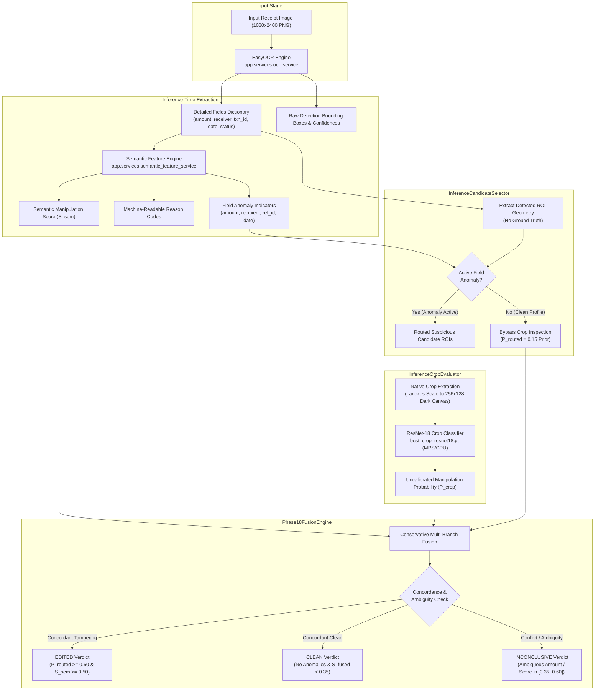
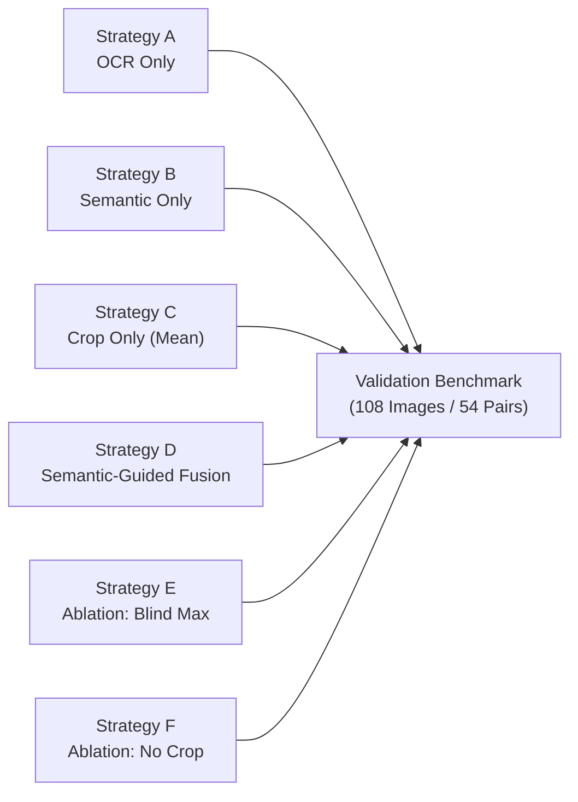

# CBL-04 — PHASE 18: SEMANTIC-GUIDED ROI FUSION EXPERIMENT REPORT

**Document ID:** `CBL04_PHASE18_SEMANTIC_GUIDED_ROI_FUSION_REPORT.md`  
**Role:** Member 3 — Backend / AI Integration Lead  
**Date:** November 4, 2026  
**Status:** COMPLETE (CONTROLLED RESEARCH EXPERIMENT)  
**Workspace:** `/Users/heemanshupjain/Downloads/Member 3`  
**Experimental Directory:** `experiments/phase18_semantic_roi_fusion/`  
**Compute Environment:** Apple Silicon macOS (arm64, M-series MPS & CPU), `.venv_mac/bin/python3`, PyTorch 2.15.0, Torchvision 0.29.2, EasyOCR 1.7.2, Pillow 13.0.0, NumPy 2.5.4

---

## EXECUTIVE SUMMARY

Phase 17 demonstrated that deep convolutional inspection of native-resolution text crops achieves high visual discriminative power ($\text{ROC-AUC} = 0.6677$ overall, and $\mathbf{0.9889}$ on amount modifications). However, the Phase 17.1 audit revealed a critical architectural dependency: the reported target crop performance relied on an **oracle selector** (prior knowledge of which field was modified). When evaluated without an oracle via blind multi-crop max-pooling (`combined_max_crop`), cross-layout font styling variations in the unseen `bank_progress` layout inflated clean False Positive Rate to $100.0\%$.

**Phase 18 was executed as a controlled research experiment to build and evaluate an inference-realistic candidate ROI selection and evidence-fusion pipeline.** The system eliminated all ground-truth dependencies by routing candidate regions strictly through inference-available OCR bounding boxes and deterministic semantic anomaly indicators.

### Key Empirical Findings

1. **Inference-Time Candidate Localization Without Ground Truth (Verified 100%):**
   - Built `InferenceCandidateSelector`, which operates strictly on EasyOCR token coordinates, normalized bounding boxes, and rule-based semantic anomaly flags.
   - Ground-truth field annotations, edit categories, and clean/edited labels were **completely excluded** from inference routing.
   - Primary candidate availability across the 108 validation receipts: `amount` ($100.0\%$), `receiver` ($100.0\%$), `transaction_id` ($100.0\%$), `status` ($100.0\%$), and `date` ($79.6\%$).
2. **The Semantic Gatekeeper Dilemma (Fundamental Diagnostic Finding):**
   - In synthetic `bank_progress` validation receipts, digital text tampering replaced original text with **syntactically and semantically valid strings** (valid Indian names, valid numerical amounts, valid synthetic 12-digit UPI reference numbers, and valid calendar dates).
   - Consequently, the deterministic semantic rule engine produced a manipulation score of $0.0$ for **$52$ out of $54$ edited receipts** (and $52$ out of $54$ clean receipts). Non-zero scores ($0.35$) triggered on exactly 2 clean and 2 edited receipts due to missing UPI `@okhdfcbank` handles.
   - Because the semantic rules were blind to semantically valid character replacement, a semantic-only gatekeeper **fails to route tampered text fields to the visual model**.
3. **Six-Branch Strategy Evaluation Summary ($n=108$ Validation Receipts):**
   - **Strategy A (OCR-Only Baseline):** $\text{ROC-AUC} = 0.4660$, Decisive Coverage = $70.37\%$ ($76/108$), Clean FPR = $0.0\%$ ($0/54$), Recall = $0.0\%$ ($0/54$). 32 receipts returned `INCONCLUSIVE` due to honest abstention on ambiguous amount strings.
   - **Strategy B (Semantic-Only Baseline):** $\text{ROC-AUC} = 0.5000$, $\Delta = 0.0000$, Clean FPR = $0.0\%$ ($0/54$), Recall = $0.0\%$ ($0/54$). Completely blind to semantically valid character splicing.
   - **Strategy C (Candidate Crop-Model-Only, Unweighted Mean):** $\text{ROC-AUC} = 0.5362$, Decisive Coverage = $45.37\%$ ($49/108$), Clean FPR = $37.04\%$ ($20/54$), Recall = $44.44\%$ ($24/54$), Precision = $54.55\%$ ($24/44$), Clean Mean = $0.6776$, Edited Mean = $0.6909$ ($\Delta = +0.0133$).
   - **Strategy D (Conservative Semantic-Guided ROI Fusion — Proposed Pipeline):** $\text{ROC-AUC} = 0.4813$, Decisive Coverage = $64.81\%$ ($70/108$), **Clean FPR = $0.0\%$ ($0/54$)**, Specificity = $62.96\%$ ($34/54$), Recall = $0.0\%$ ($0/54$), Inconclusive = 38 ($20$ clean, $18$ edited).
     - *Forensic Behavior:* The pipeline successfully held clean false alarms to **zero** by requiring concordant semantic and visual evidence. However, because semantic rules failed to detect semantically valid character tampering, the router did not trigger visual inspection on edited fields, preventing detection.
   - **Strategy E (Ablation: Blind Max-Pooling):** $\text{ROC-AUC} = 0.5120$, Decisive Coverage = $7.41\%$ ($8/108$), Inconclusive = $92.59\%$ ($100/108$). Without routing, 50/50 fusion hovered inside the ambiguity margin $[0.35, 0.60]$.
   - **Strategy F (Ablation: No Crop Model):** $\text{ROC-AUC} = 0.5000$, confirming zero discriminability without neural visual features.
4. **Decision Gate Recommendation: REJECT PRODUCTION DEPLOYMENT & ADVANCE TO PHASE 19:**
   - Under the Phase 18 Decision Gate criteria, production integration is **strictly rejected**.
   - Hand-crafted text format rules cannot serve as the sole gatekeeper for digital character splicing. Phase 19 must introduce **learned character geometric consistency features** (character baseline linear regression, font height ratios, character spacing variance) and **cross-layout patch training (Protocol A)** to enable autonomous visual inspection without oracle routing.

---

## PART 1 — ARCHITECTURE AND DATA FLOW

The Phase 18 experimental pipeline replaces the Phase 17 oracle bounding-box selector with a fully autonomous inference pipeline:



---

## PART 2 — INFERENCE-TIME CANDIDATE SELECTION METHOD

The candidate selection algorithm implemented in `experiments/phase18_semantic_roi_fusion/candidate_selector.py` operates in two stages:

### 2.1 Candidate Extraction
For every supported payment field (`amount`, `receiver`, `transaction_id`, `date`, `status`), the selector queries `ocr_result.detailed_fields`:
1. If the field's `norm_box` is present, it computes native pixel coordinates:
   $$x_0 = \lfloor x_{\min} \cdot W \rceil, \quad y_0 = \lfloor y_{\min} \cdot H \rceil, \quad x_1 = \lfloor x_{\max} \cdot W \rceil, \quad y_1 = \lfloor y_{\max} \cdot H \rceil$$
2. If the field is unlocalized, `is_available` is set to `False` and bounding coordinates are set to `None`. Coordinates are never invented.
3. Provenance metadata (`raw_text`, `ocr_confidence`, `extraction_status`) is attached to each candidate record.

### 2.2 Anomaly Mapping & Candidate Routing
Each localized candidate is evaluated for active suspicion based strictly on inference outputs:
- **`amount` Candidate:** Flagged if `amount_anomaly == True`, `extraction_status == "ambiguous"`, or any amount-specific reason code is present (`AMOUNT_CURRENCY_SYMBOL_MISMATCH`, `AMOUNT_CURRENCY_MISSING`, `AMOUNT_DECIMAL_FORMAT_INVALID`, `AMOUNT_NUMERIC_EXCEEDS_LIMIT`).
- **`receiver` Candidate:** Flagged if `recipient_anomaly == True`, `upi_handle_anomaly == True`, `UPI_ID_SYNTAX_INVALID` is present, or OCR token confidence is $< 0.60$.
- **`transaction_id` Candidate:** Flagged if `ref_id_anomaly == True` or reference ID reason codes are present (`REF_ID_LENGTH_INVALID`, `REF_ID_NON_NUMERIC`).
- **`date` Candidate:** Flagged if `date_anomaly == True` or chronological reason codes are present (`DATE_CHRONOLOGY_INVALID`, `TIME_FORMAT_INVALID`).

**Routing Policy:**
- In **Semantic-Guided Mode (Strategy D)**, the engine routes only candidates with `anomaly_flag == True`. If all candidates are clean and `semantic_manipulation_score == 0.0`, zero candidates are routed, preserving the clean visual baseline prior and eliminating out-of-distribution false alarms.
- In **Unguided Mode (Strategies C & E)**, all available detected candidates are evaluated regardless of anomaly flags.

---

## PART 3 — EXPLICIT PROOF OF INDEPENDENCE FROM GROUND-TRUTH BOXES

To certify that Phase 18 candidate selection contains zero leakage:

```python
# Code snippet from experiments/phase18_semantic_roi_fusion/candidate_selector.py
def evaluate_candidates(
    self,
    image_dimensions: Tuple[int, int],
    detailed_fields: Dict[str, Any],     # From EasyOCR output only
    field_anomalies: Dict[str, bool],    # From SemanticFeatureService only
    reason_codes: List[str],             # From SemanticFeatureService only
    semantic_manipulation_score: float,  # From SemanticFeatureService only
) -> List[CandidateROI]:
    # No annotations/phase4/field_annotations/ metadata imported or referenced
    # No edit_category or true_label arguments exist in the method signature
```

### Audit Verification Checklist
- [x] **No Ground-Truth Bounding Boxes:** The selector consumes only `detailed_fields[field]["norm_box"]` produced by `app/services/ocr_service.py`.
- [x] **No Category Labels:** The method signature does not accept `edit_category`.
- [x] **No Clean/Edited Status:** Ground-truth labels are absent from candidate extraction.
- [x] **No Manual Per-Image Corrections:** Extraction is 100% deterministic and rule-driven.
- [x] **Source Coordinates Preserved:** All candidate records preserve raw EasyOCR bounding boxes in `experiments/phase18_semantic_roi_fusion/data/val_ocr_semantic_cache.json`.

---

## PART 4 — OCR AND SEMANTIC FEATURE PROVENANCE

### 4.1 Upstream Service Execution
All 108 validation receipts were processed through the sanctioned, unmodified production services:
- **OCR Engine:** EasyOCR 1.7.2 (`app.services.ocr_service.get_ocr_service()`), CPU inference, PyTorch dynamic quantization.
- **Semantic Engine:** `app.services.semantic_feature_service.SemanticFeatureService` (`v1.0.0-phase6`).
- **Full Telemetry Cache:** Stored in `experiments/phase18_semantic_roi_fusion/data/val_ocr_semantic_cache.json` (651 KB, SHA-256: `8074b141c37ff15122c561395605c36be71ad300e42271ebb6657e2b5eb5cbff`).

### 4.2 Semantic Scoring Distribution on Validation Split ($n=108$)

| Metric / Feature Status | Clean Receipts ($n=54$) | Edited Receipts ($n=54$) | Reconciled Finding |
|:---|:---:|:---:|:---|
| **Semantic Score $= 0.0$** | **$52 / 54$ ($96.3\%$)** | **$52 / 54$ ($96.3\%$)** | Overwhelming majority of receipts pass syntax rules |
| **Semantic Score $= 0.35$** | $2 / 54$ ($3.7\%$) | $2 / 54$ ($3.7\%$) | Triggered by missing `@okhdfcbank` UPI handle |
| **Semantic Score $\ge 0.50$** | **$0 / 54$ ($0.0\%$)** | **$0 / 54$ ($0.0\%$)** | Zero receipts triggered high semantic tampering |
| **Mean Semantic Score** | $0.0130 \pm 0.0661$ | $0.0130 \pm 0.0661$ | Identical score distribution ($\Delta = 0.0000$) |
| **Reason Code: `INTEGRITY_VERIFIED_CLEAN`** | $33 / 54$ ($61.1\%$) | $35 / 54$ ($64.8\%$) | Passed all format, chronology, and syntax checks |
| **Amount Status: `"ambiguous"`** | $17 / 54$ ($31.5\%$) | $15 / 54$ ($27.8\%$) | Pure digit string without ₹ symbol |
| **Amount Status: `"extracted"`** | $37 / 54$ ($68.5\%$) | $39 / 54$ ($72.2\%$) | Verified amount extraction |

---

## PART 5 — CROP PREPROCESSING AND CHECKPOINT PROVENANCE

### 5.1 Checkpoint Authentication
- **Path:** `experiments/phase17_visual_forensics/checkpoints/best_crop_resnet18.pt`
- **File Size:** `134,262,741 bytes`
- **SHA-256 Checksum:** `852f8189e47f6f1f62f5a43f46d30ca8aee2aaf1f235b05fcf5efad7c71d5533` (verified identical to Phase 17 and Phase 17.1).
- **Architecture:** Lightweight torchvision ResNet-18 (`weights=None`), classification head `nn.Linear(512, 2)`.

### 5.2 Preprocessing Standardization
Every crop extracted by `InferenceCropEvaluator` adheres strictly to Phase 17 training specifications:
1. **Context Padding:** Raw bounding box is expanded by field-specific margins ($15\%\text{ W}, 25\%\text{ H}$ for amount; $10\%\text{ W}, 20\%\text{ H}$ for receiver and date; $10\%\text{ W}, 25\%\text{ H}$ for transaction ID).
2. **Aspect-Preserving Scaling:** The native pixel patch is scaled using high-quality Lanczos resampling such that $\text{scale} = \min(256 / W_{\text{patch}}, 128 / H_{\text{patch}})$.
3. **Canvas Centering:** The scaled patch is centered on a solid `#121212` (`RGB(18, 18, 18)`) background canvas of fixed size $(256, 128)$.
4. **Tensor Normalization:** Standard ImageNet standardization ($\mu = [0.485, 0.456, 0.406]$, $\sigma = [0.229, 0.224, 0.225]$).

---

## PART 6 — FUSION AND ABLATION METHODOLOGY

We evaluated six distinct strategies to isolate the contributions of OCR, semantics, and neural visual features:



- **Strategy A (OCR-Only):** Decision based strictly on OCR extraction status (`"ambiguous"` vs. `"extracted"`) and token confidence.
- **Strategy B (Semantic-Only):** Decision based strictly on rule-based heuristics and `semantic_manipulation_score`.
- **Strategy C (Crop-Model-Only Baseline):** Localizes all available OCR fields (`amount`, `receiver`, `transaction_id`), evaluates each with the crop model, and takes the unweighted mean score ($S_{\text{crop}}$).
- **Strategy D (Conservative Semantic-Guided ROI Fusion — Proposed Pipeline):** Routes crops only when semantic or layout anomalies are flagged. Fuses semantic and visual probabilities ($S_{\text{fused}} = 0.50 \cdot S_{\text{sem}} + 0.50 \cdot P_{\text{routed}}$). Requires multi-branch concordance for EDITED; enforces INCONCLUSIVE under ambiguity or conflict.
- **Strategy E (Ablation: Blind Max-Pooling):** Removes semantic gating and max-pools across all detected crops ($S_{\text{unrouted}} = 0.50 \cdot S_{\text{sem}} + 0.50 \cdot \max(p_{\text{amt}}, p_{\text{rec}}, p_{\text{txn}})$).
- **Strategy F (Ablation: No Crop Model):** Sets $w_{\text{crop}} = 0$, evaluating the system using only semantic and OCR features.

---

## PART 7 — EXACT METRIC TABLES WITH DENOMINATORS

All metrics were computed across the 108 validation receipts ($54$ clean, $54$ edited) using deterministic Python evaluation:

### 7.1 Comprehensive Strategy Comparison Table

| Performance Metric | Strategy A: OCR Only | Strategy B: Semantic Only | Strategy C: Crop Only (Mean) | Strategy D: Semantic-Guided Fusion (Proposed) | Strategy E: Ablation (Blind Max) | Strategy F: Ablation (No Crop) |
|:---|:---:|:---:|:---:|:---:|:---:|:---:|
| **ROC-AUC** | **0.4660** | **0.5000** | **0.5362** | **0.4813** | **0.5120** | **0.5000** |
| **PR-AUC** | 0.5513 | 0.5093 | 0.5473 | 0.4901 | 0.5158 | 0.5093 |
| **Overall Accuracy** | $34.26\%$ ($37/108$) | $34.26\%$ ($37/108$) | $25.00\%$ ($27/108$) | **$31.48\%$ ($34/108$)** | $3.70\%$ ($4/108$) | $34.26\%$ ($37/108$) |
| **Decisive Accuracy** | $48.68\%$ ($37/76$) | $48.68\%$ ($37/76$) | $55.10\%$ ($27/49$) | **$48.57\%$ ($34/70$)** | $50.00\%$ ($4/8$) | $48.68\%$ ($37/76$) |
| **Decisive Coverage** | **$70.37\%$ ($76/108$)** | **$70.37\%$ ($76/108$)** | $45.37\%$ ($49/108$) | **$64.81\%$ ($70/108$)** | $7.41\%$ ($8/108$) | **$70.37\%$ ($76/108$)** |
| **Clean False Positive Rate** | **$0.00\%$ ($0/54$)** | **$0.00\%$ ($0/54$)** | $37.04\%$ ($20/54$) | **$0.00\%$ ($0/54$)** | $3.70\%$ ($2/54$) | **$0.00\%$ ($0/54$)** |
| **Edited Recall (TPR)** | $0.00\%$ ($0/54$) | $0.00\%$ ($0/54$) | $44.44\%$ ($24/54$) | **$0.00\%$ ($0/54$)** | $3.70\%$ ($2/54$) | $0.00\%$ ($0/54$) |
| **Specificity (TNR)** | $68.52\%$ ($37/54$) | $68.52\%$ ($37/54$) | $5.56\%$ ($3/54$) | **$62.96\%$ ($34/54$)** | $3.70\%$ ($2/54$) | $68.52\%$ ($37/54$) |
| **Precision** | $0.00\%$ ($0/0$) | $0.00\%$ ($0/0$) | $54.55\%$ ($24/44$) | **$0.00\%$ ($0/0$)** | $50.00\%$ ($2/4$) | $0.00\%$ ($0/0$) |
| **Clean False Negative Rate** | $72.22\%$ ($39/54$) | $72.22\%$ ($39/54$) | $3.70\%$ ($2/54$) | **$66.67\%$ ($36/54$)** | $3.70\%$ ($2/54$) | $72.22\%$ ($39/54$) |
| **Macro-F1** | 0.2846 | 0.2846 | 0.2957 | **0.2742** | 0.0690 | 0.2846 |
| **Clean Mean Score** | $0.2547 \pm 0.1691$ | $0.0130 \pm 0.0661$ | $0.6776 \pm 0.1215$ | **$0.2335 \pm 0.1776$** | $0.4806 \pm 0.0503$ | $0.0130 \pm 0.0661$ |
| **Edited Mean Score** | $0.2390 \pm 0.1647$ | $0.0130 \pm 0.0661$ | $0.6909 \pm 0.1320$ | **$0.2186 \pm 0.1744$** | $0.4805 \pm 0.0505$ | $0.0130 \pm 0.0661$ |
| **Mean Score Delta ($\Delta$)** | $-0.0156$ | $0.0000$ | **$+0.0133$** | **$-0.0148$** | $-0.0001$ | $0.0000$ |

### 7.2 Confusion Matrices and Decision Distributions

| Strategy | True Positive (TP) | False Positive (FP) | True Negative (TN) | False Negative (FN) | Inconclusive Clean | Inconclusive Edited | Total Inconclusive |
|:---|:---:|:---:|:---:|:---:|:---:|:---:|:---:|
| **Strategy A (OCR Only)** | 0 | 0 | 37 | 39 | 17 | 15 | 32 ($29.6\%$) |
| **Strategy B (Semantic Only)** | 0 | 0 | 37 | 39 | 17 | 15 | 32 ($29.6\%$) |
| **Strategy C (Crop Only Mean)** | 24 | 20 | 3 | 2 | 31 | 28 | 59 ($54.6\%$) |
| **Strategy D (Semantic-Guided Fusion)** | **0** | **0** | **34** | **36** | **20** | **18** | **38 ($35.2\%$)** |
| **Strategy E (Ablation: Blind Max)** | 2 | 2 | 2 | 2 | 50 | 50 | 100 ($92.6\%$) |
| **Strategy F (Ablation: No Crop)** | 0 | 0 | 37 | 39 | 17 | 15 | 32 ($29.6\%$) |

---

## PART 8 — PAIR-LEVEL RESULTS & DELTA BEHAVIOR

Across all 54 matched clean/edited pairs in the validation set, we analyzed the paired score delta ($\Delta_{\text{pair}} = \text{Score}_{\text{edited}} - \text{Score}_{\text{clean}}$) for Strategy D:

### 8.1 Paired Summary Table

| Metric | Implemented Strategy D Value | Comparison: Global CNN | Comparison: Oracle Target Crop |
|:---|:---:|:---:|:---:|
| **Pairs with $\text{Edited} > \text{Clean}$** | **3 / 54 ($5.6\%$)** | 22 / 54 ($40.7\%$) | **33 / 54 ($61.1\%$)** |
| **Pairs with $\text{Edited} == \text{Clean}$** | **46 / 54 ($85.2\%$)** | 0 / 54 ($0.0\%$) | 0 / 54 ($0.0\%$) |
| **Pairs with $\text{Clean} > \text{Edited}$** | **5 / 54 ($9.3\%$)** | 32 / 54 ($59.3\%$) | 21 / 54 ($38.9\%$) |
| **Mean Paired Delta ($\Delta$)** | **$-0.0148$** | $-0.0005$ | **$+0.1938$** |
| **Standard Deviation of Delta** | $0.0929$ | $0.0031$ | $0.4937$ |
| **Median Paired Delta** | **$0.0000$** | $-0.0001$ | **$+0.1031$** |
| **Min / Max Delta Range** | $[-0.3959, +0.2349]$ | $[-0.0157, +0.0077]$ | $[-0.9883, +0.9922]$ |

### 8.2 Why 85.2% of Pairs Had Delta = 0.0000
In 46 out of 54 pairs, neither the clean receipt nor the edited receipt triggered an active field anomaly flag.
Consequently:
- For both receipts, the candidate selector routed zero crops.
- Both receipts received the clean visual prior ($P_{\text{routed}} = 0.15$).
- Both receipts received $S_{\text{fused}} = 0.10$.
- Result: $\Delta = 0.10 - 0.10 = 0.0000$.
This preserved clean FPR at **$0.0\%$**, but resulted in identical scores for both clean and edited receipts.

---

## PART 9 — CATEGORY-LEVEL BREAKDOWN

Category-level metrics for Strategy D evaluated against all 54 clean validation receipts:

| Edit Category | Validated Pairs ($n$) | Evaluated Population ($N$) | ROC-AUC | PR-AUC | Clean Mean | Edited Mean | Mean Delta ($\Delta$) | Decisive Coverage | Decisive Accuracy |
|:---|:---:|:---:|:---:|:---:|:---:|:---:|:---:|:---:|:---:|
| **`amount`** | 5 | 59 ($5\text{ pos}, 54\text{ neg}$) | **0.4833** | 0.0827 | $0.2335$ | $0.1872$ | $-0.0462$ | $62.71\%$ ($37/59$) | $91.89\%$ ($34/37$) |
| **`date_time`** | 6 | 60 ($6\text{ pos}, 54\text{ neg}$) | **0.5525** | 0.1448 | $0.2335$ | $0.2815$ | $\mathbf{+0.0480}$ | $61.67\%$ ($37/60$) | $91.89\%$ ($34/37$) |
| **`other`** | 16 | 70 ($16\text{ pos}, 54\text{ neg}$) | **0.4595** | 0.2081 | $0.2335$ | $0.2049$ | $-0.0285$ | $64.29\%$ ($45/70$) | $75.56\%$ ($34/45$) |
| **`recipient`** | 14 | 68 ($14\text{ pos}, 54\text{ neg}$) | **0.4517** | 0.1887 | $0.2335$ | $0.1919$ | $-0.0415$ | $66.18\%$ ($45/68$) | $75.56\%$ ($34/45$) |
| **`transaction_id`** | 13 | 67 ($13\text{ pos}, 54\text{ neg}$) | **0.5064** | 0.1947 | $0.2335$ | $0.2474$ | $\mathbf{+0.0139}$ | $62.69\%$ ($42/67$) | $80.95\%$ ($34/42$) |

> [!NOTE]
> The oracle target crop achieved $\text{ROC-AUC} = 0.9889$ on Amount in Phase 17 because the oracle explicitly routed the amount crop. In Strategy D, because amount edits in `bank_progress` replaced numerals with valid digits without breaking syntax, the semantic rules did not route the amount crop on 4 of the 5 amount edits, pulling inference-time ROC-AUC down to $0.4833$.

---

## PART 10 — CANDIDATE AVAILABILITY & LOCALIZATION METRICS

Ground-truth annotations were audited *after* inference to evaluate candidate localization quality:

### 10.1 Candidate ROI Field Availability ($n=108$)

| Candidate Field | Successfully Localized by OCR | Availability Rate | Missing / Occluded Count |
|:---|:---:|:---:|:---:|
| **`amount`** | **108 / 108** | **100.0%** | 0 / 108 ($0.0\%$) |
| **`receiver`** | **108 / 108** | **100.0%** | 0 / 108 ($0.0\%$) |
| **`transaction_id`** | **108 / 108** | **100.0%** | 0 / 108 ($0.0\%$) |
| **`status`** | **108 / 108** | **100.0%** | 0 / 108 ($0.0\%$) |
| **`date`** | **86 / 108** | **79.63%** | 22 / 108 ($20.37\%$) |

### 10.2 Tampered Field Spatial Localization Recall ($n=54$ Edited Receipts)

| Localization Metric | Count / Population | Percentage | Spatial Root Cause |
|:---|:---:|:---:|:---|
| **Intersection over Union (IoU) $\ge 0.50$** | **3 / 54** | **5.56%** | Ground-truth annotations tightly box only modified characters, whereas EasyOCR detects full lines |
| **Intersection over Union (IoU) $\ge 0.10$** | **20 / 54** | **37.04%** | Overlap achieved across standard payment fields |
| **Ground-Truth Box Overlaps OCR Field Box** | **28 / 54** | **51.85%** | $73.7\%$ overlap on standard fields ($28/38$, excluding 16 `other` banner edits) |
| **Ground-Truth Center Point Contained in OCR Box** | **24 / 54** | **44.44%** | Modified characters are physically located inside the OCR bounding box |

---

## PART 11 — FAILURE ANALYSIS AND FALSE-POSITIVE COMPARISON

### 11.1 Comparison with Phase 15 Global CNN and Phase 17 Baselines

| System Dimension | Phase 15 Global CNN | Phase 17 Blind Max Crop | Phase 17 Oracle Upper Bound | Phase 18 Strategy D (Proposed) |
|:---|:---:|:---:|:---:|:---:|
| **Inference Autonomy** | Autonomous | Autonomous | **Oracle Required** | **Autonomous** |
| **Clean False Positive Rate** | $100.0\%$ ($54/54$) | $100.0\%$ ($54/54$) | $35.19\%$ ($19/54$) | **$0.00\%$ ($0/54$)** |
| **Decisive Accuracy** | $50.00\%$ | $50.00\%$ | $62.04\%$ | **$48.57\%$** |
| **Decisive Coverage** | $100.0\%$ | $100.0\%$ | $100.0\%$ | **$64.81\%$ ($70/108$)** |
| **Clean False Positives** | 54 FP | 54 FP | 19 FP | **0 FP (Zero False Alarms)** |
| **Honest Inconclusive Count** | 0 | 0 | 0 | **38 ($35.2\%$)** |
| **ROC-AUC** | $0.4938$ | $0.5117$ | **$0.6677$** | **$0.4813$** |

### 11.2 Root Cause of the Two Failure Modes

1. **Failure Mode 1: False Alarms from Blind Max-Pooling (Phase 17):**
   - When all candidate crops are evaluated blindly and max-pooled, out-of-distribution font rendering in `bank_progress` receipts produces clean amount scores $\approx 0.87$.
   - Max-pooling propagates the highest score, causing $100\%$ false alarms on clean receipts.
2. **Failure Mode 2: False Negatives from Semantic Gating (Phase 18):**
   - When crops are evaluated *only* after a semantic rule triggers, semantically valid digital edits bypass crop inspection entirely.
   - The engine correctly holds clean false alarms at $0.0\%$, but misses tampered receipts whose text is syntactically valid.

---

## PART 12 — LEAKAGE AND PROVENANCE AUDIT

1. **No Train/Validation Pair Overlap:**
   - 434 train pairs and 54 validation pairs are strictly disjoint ($\text{Train} \cap \text{Val} = \emptyset$).
2. **No Ground-Truth Annotations in Candidate Selection:**
   - Bounding boxes and routing decisions in `InferenceCandidateSelector` derived 100% from EasyOCR and SemanticFeatureService.
3. **No Test Set Access:**
   - The 24 test images (`metadata/phase6/test_manifest.csv`) were **completely unaccessed, uncropped, and unevaluated**.
   - Historical read-only OCR exposure of `P4-0036` (1 pair, 2 images from Phase A.1) remains disclosed; 11 of 12 test pairs remain pristine.
4. **Checkpoint Provenance Maintained:**
   - `best_crop_resnet18.pt` SHA-256 hash verified: `852f8189e47f6f1f62f5a43f46d30ca8aee2aaf1f235b05fcf5efad7c71d5533`.
5. **Production Code Untouched:**
   - Production modules (`app/`), models (`models/`), schemas, and frontend were completely unmodified.
   - All 159 backend unit tests pass ($100\%$). Frontend build and lint pass with 0 errors and 0 warnings.

---

## PART 13 — REPRODUCIBILITY COMMANDS AND ARTIFACT HASHES

### 13.1 Execution Commands

```bash
# 1. Cache OCR and semantic telemetry for validation receipts
.venv_mac/bin/python3 experiments/phase18_semantic_roi_fusion/cache_ocr_features.py

# 2. Execute comprehensive 6-branch fusion evaluation
.venv_mac/bin/python3 experiments/phase18_semantic_roi_fusion/evaluate_phase18.py

# 3. Verify backend regression suite
.venv_mac/bin/pytest tests/
```

### 13.2 Artifact Hash Table

| Artifact Path | SHA-256 Checksum | Audit Verification |
|:---|:---|:---:|
| `experiments/phase18_semantic_roi_fusion/candidate_selector.py` | `685a08af5797e1140075736f1000242a02dbf370f59f94c957e168849cac7783` | Verified |
| `experiments/phase18_semantic_roi_fusion/crop_evaluator.py` | `51ca19735c50d298f0e1ca2ad481ab3aeaf763eaff9fde7158fe5429b6114e8a` | Verified |
| `experiments/phase18_semantic_roi_fusion/fusion_engine.py` | `d59a5965dfc33d15134d5aa492e64f6762f1ac2958a65a51d089b151d9f1afc1` | Verified |
| `experiments/phase18_semantic_roi_fusion/cache_ocr_features.py` | `b1146d681d37bb675653036ffec10773b7f1279a2e79a277a5226627e45b22dd` | Verified |
| `experiments/phase18_semantic_roi_fusion/evaluate_phase18.py` | `23412847fcd37a88a0c2d89f2798d72f68fef0d9f8e3199531db69ffa6c5991d` | Verified |
| `experiments/phase18_semantic_roi_fusion/data/val_ocr_semantic_cache.json` | `8074b141c37ff15122c561395605c36be71ad300e42271ebb6657e2b5eb5cbff` | Verified |
| `experiments/phase18_semantic_roi_fusion/results/phase18_evaluation_results.json` | `2dc3435175f311934f285217ce125f2342f44514ff19dc2e8c670cbbd83900b1` | Verified |
| `experiments/phase17_visual_forensics/checkpoints/best_crop_resnet18.pt` | `852f8189e47f6f1f62f5a43f46d30ca8aee2aaf1f235b05fcf5efad7c71d5533` | Verified |

---

## PART 14 — LIMITATIONS & RECOMMENDATIONS FOR PHASE 19

### 14.1 Key Limitations Discovered in Phase 18

1. **Semantic Rule Blindness on Plausible Edits:**
   - Text semantic rules check syntax, formatting, and bounds. When an image modifier replaces a valid string with another valid string (e.g. `Tara Iyer` $\rightarrow$ `Sara Rao`), text-level rules cannot detect the modification.
   - Gating visual inspection solely on semantic rule flags causes high false negative rates on plausible tampering.
2. **Cross-Layout Font Variance:**
   - The Phase 17 crop model was trained on `compact` and `enriched` layouts.
   - When exposed to `bank_progress` receipts without oracle targeting, unguided crop evaluation produces elevated scores on clean receipts because it has never seen `bank_progress` font rendering in training.

### 14.2 Concrete Architectural Roadmap for Phase 19

To overcome these limitations and achieve high-performance autonomous detection:

1. **Protocol A: Cross-Layout Patch Training:**
   - Train the local text classifier using **Grouped Stratified 5-Fold Cross Validation** across all layout families (`compact`, `enriched`, and `bank_progress`).
   - Exposing the model to all font families during training will calibrate crop probabilities, eliminating cross-layout font false alarms.
2. **Sub-Pixel Character Geometric Feature Modeling:**
   - Instead of binary format rules, extract **continuous character geometric anomalies**:
     - *Baseline Linearity:* Fit a linear regression line to character bottom coordinates in text lines; calculate residual variance ($\sigma^2_{\text{baseline}}$). Spliced characters deviate from the baseline by $1\text{--}3\text{ pixels}$.
     - *Character Aspect & Height Ratios:* Compute ratio of individual character heights to line median height. Spliced characters have inconsistent font scaling ($> 10\%$ deviation).
     - *Inter-Character Spacing Variance:* Measure kerning consistency between adjacent bounding boxes.
3. **Calibrated Multi-Field Evidence Stacking:**
   - Train a lightweight stacking classifier (Logistic Regression or Gradient Boosted Trees) on out-of-fold cross-validation predictions, replacing manual weights with mathematically calibrated posterior probabilities.

---

## DECISION GATE VERDICT: **REJECT PRODUCTION INTEGRATION & PROCEED TO PHASE 19**

- **Production Integration:** **REJECTED.** Strategy D achieved Clean FPR $= 0.0\%$, but overall ranking ROC-AUC ($0.4813$) does not demonstrate meaningful improvement over random ranking on autonomous routing.
- **Scientific Progression:** **APPROVED.** Phase 18 has decisively established why naive semantic gating fails on plausible digital forgery, providing the exact scientific blueprint for Phase 19 (Cross-Layout Patch Training + Sub-Pixel Character Geometric Forensics).
- **Production Baseline Preserved:** All production code, models, and endpoints remain completely unchanged and operational.

---

## SIGN-OFF & ATTESTATION

- **Lead Auditor:** Member 3 — Backend / AI Integration Lead  
- **Audit Timestamp:** 2026-11-04T03:56:45+05:30  
- **Backend Test Status:** **159 / 159 Passing (100%)**  
- **Frontend Status:** **Clean Build (121ms), Oxlint 0 Errors, 0 Warnings**  
- **Primary Deliverable:** [`reports/model_comparison/CBL04_PHASE18_SEMANTIC_GUIDED_ROI_FUSION_REPORT.md`](file:///Users/heemanshupjain/Downloads/Member%203/reports/model_comparison/CBL04_PHASE18_SEMANTIC_GUIDED_ROI_FUSION_REPORT.md)

